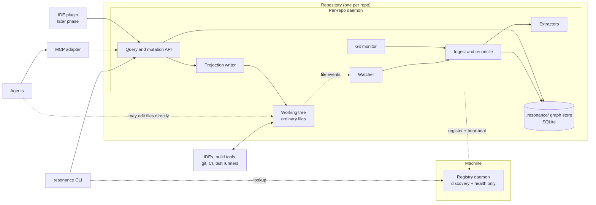

# Resonance: Graph-Primary Software Projects — Specification


| **Version** | 0.1 (initial draft) |
| **Date** | 2026-09-28 |
| **Owner** | Mark |
| **Status** | Draft for expansion. Nothing here is implemented. |
| **Name** | Resonance. The CLI is `resonance` and the in-repo directory is `.resonance/`. |

---

## 0. How to read this document

This specification is meant to be expanded over time and to be something an agent can implement from. To keep it honest about what has actually been decided, every significant statement carries one of three status labels:

- **[Decided]** — stated by Mark as a decision or position.
- **[Proposed]** — recommended during design discussion but not yet confirmed by Mark. Treat as the default until reviewed.
- **[Open]** — unresolved. Listed again in §14.

Requirements use stable IDs (`FR-###` functional, `NFR-###` non-functional, `OQ-##` open questions) and RFC 2119 keywords (MUST, SHOULD, MAY). Stable IDs matter here for a second reason: this document is intended to be the first body of intent the system ingests about itself (see §8.10), so its requirement IDs should never be renumbered. Retire an ID rather than reuse it.

Appendix A checks this specification against Mark's own statements and lists the tensions found between them.

---

## 1. Summary

Resonance is a per-repository system that keeps a **graph database as the source of truth** for a software project: its requirements, design decisions, code units, tests, annotations, and the typed relationships between them. It **projects a standard, fully tool-compatible working tree onto disk**, so build systems, IDEs, git and CI keep working on ordinary files without modification. Agents and developers reach the extra graph information through a **separate API**; the files on disk never show it.

The system's primary purpose is **traceability between intent and implementation**: letting a developer move directly from a requirement to the code that satisfies it and the tests that verify it, and back again, and letting developers annotate and call out code for agents in a structured, durable way. Code structure (syntax and symbols) is a supporting, derived layer, not the product.  Of course traceability would not stop at code -- it would continue into the products and artifacts produced by mapping intent all the way through to behavior of the generated solution and back. 

---

## 2. Motivation and thesis

### 2.1 Files on disk (FOD) is becoming obsolete as the primary working model  [Decided]

Mark's thesis: the model in which agents and developers work primarily by reading and editing files on disk ("FOD") is extremely inefficient, i.e. agents are hamstrung working with files when a more efficient and expressive encoding would benefit both agents and humans in their tasks. Agents can, and should, work with a representation and protocol that suits their abilities and that connects code to the higher-level concerns that increasingly define software work: requirements, design, and alignment. Software development will continue to be defined even more as a system that takes inputs and that produces useful outputs. We merely mean to emphasize to the extreme the boundaries where humans and agents communicate while this project fills in the middle that handles the semantic mappings through and back.

### 2.2 Where developer effort moves  [Decided]

Developers increasingly concentrate on describing the behavior a solution must have. The mechanism for that is high-level design documents and requirements. Meanwhile agents generate solutions behind the scenes, of which code is only one part (other parts include, for example, tests, configuration and documentation). During the migration between models, the critical capability is a representation that lets developers step directly between:

- requirements,
- the code (and other artifacts) generated from those requirements that satisfies them,
- the tests that exercise that code,
- the solution ultimately generated,

It will be too much to ask that developers immediately quantum leap into a word where they no longer interact with code; an intermediate state of humans and agents have equal agency over code must be created. That will require a reasonable and expressive way to communicate about all aspects of software development until agents are sufficiently adept to abstract solely from requirements. Thus developers who still work at the code level must be able to **annotate and call out** specific functions and other constructs to an agent.

### 2.3 Why a graph  [Decided]

A graph database breaks the project into nodes and relations that can each be annotated with **agreed-upon semantics**. An agent, and eventually an IDE that speaks the same graph model, can then work from that shared model to generate solutions, but to also under how behavior of a solution is reflected/inferred (or not) in the provided requirements and designs.

### 2.4 Files as compiled output, not as obsolete  [Decided]

Compilers, runtimes, CI, code review and deployment will continue to consume text files for a long time, and language models are strongest at reading and writing text. The working position of this specification is therefore that **source files become a projection of the graph**, much as assembly is a projection of a compiled program: still present and still executed, but no longer where developers and agents do their thinking. This is also what makes adoption possible: existing projects can adopt Resonance without giving anything up.

A corollary of this perspective is that migration to any tooling cannot be instantaneous, and to be successful a reasonable migration path must be supported. Supporting file trees is thus viewed as a required to support current tooling, but nonetheless a temporary condition that will be replaced by updated tooling that operates on the graph model natively. In the extreme files are but an (optional) implementation detail. 

Taking this model to its logical conclusion Resonance will offer a container in which nearly all of existing tooling, and the creation of "software" itself is but an implementation detail. This is similar to how compilers obscure the transformation of code into assembly, so too will Resonance provide the scaffolding necessary to obscure the next abstraction level of the software development lifecycle.

### 2.5 Position on code structure  [Decided]

Mark is skeptical that giving agents easy access to *code structure* (as Mache does, using tree-sitter) is a first-order benefit. Agents already handle large codebases well when requests are well structured. Structural access is likely a second- or third-order efficiency gain, useful mainly for planning and verifying large refactors. Consequences for this specification:

- The code-structure layer is **derived, cheap, and secondary** (§8.9).
- The product's value is concentrated in the **intent and verification layers** (§6).
- Whether structure measurably helps is **tested before building** (§11, Phase 0).

To the extent code structure is meaningful, it will need to be replaced by tooling that produces views that fit an "agent's mind". It is not yet clear how that tooling is to be created.

### 2.6 Why this can work now when earlier attempts stalled  [Decided]

Requirements traceability tools, model-driven architecture, Intentional Programming, Smalltalk images, JetBrains MPS and similar systems mostly stalled because **humans had to maintain the links**, the links drifted from reality, and people stopped trusting them. Agents change the economics: keeping links current is cheap and continuous for an agent. Two conditions follow, and they shape the design:

1. **Link maintenance is the core product**, not a side feature.
2. **Links must be checkable.** A `verifies` link backed by a passing test is evidence; a `satisfies` link nothing checks will eventually be wrong. The design prefers links that execution can confirm (§6.5).

### 2.7 Core tooling, like source tooling, will eventually live in Resonance and be replaced by it [Decided]

Software development is collaborative, and artifacts of that collaboration leave a trail of essential context. Tickets in JIRA, commit messages in git, and comments on pull/merge requests are essential context that document both the history of a system, but the reasons why some particular set of decisions are suitable or not.

As such, Resonance offers a core data model that supports capturing this context as part of a larger set of collaborative tools. The leverage, however, is not that we can just capture particular messages, but that we can capture those messages *within and linking to the wider context* of a point-in-time snapshot of a (presumably) working system. Said another way, each type of message (ticket comment, source change, merge comment) is meta-commentary about the design and requirements that capture the evolution of those entities in relation to the solution/output, and is essential and easy to capture.

While Resonance will have to support living inside `git` for the foreseeable future, Resonance will also simultaneously offer its own native change control system, mimicking the git command line interface though diverging in implementation and semantics.

Speculating ever further, Resonance-built solutions could someday support a mechanism of producing data packets that capture behavior of a running solution. This would give insight back to Resonance internal tools on how to optimize against real usage, but also could capture developer (or user) commentary on things to change or improve.

---

## 3. Goals and non-goals

### 3.1 Goals

- **G1** — Make requirements, decisions, code units, tests and annotations first-class, typed, queryable nodes with typed relationships. [Decided]
- **G2** — Let a developer or agent traverse requirement → code → test and back in one query. [Decided]
- **G3** — Let code-fluent developers annotate and call out code units to agents, with annotations that survive ordinary edits. [Decided]
- **G4** — Keep the working tree a standard software project, with all extra graph information behind a separate API. [Decided]
- **G5** — Work well with build systems, IDEs and source control, which requires ordinary file-system events. [Decided]
- **G6** — Integrate with git using a git-friendly algebra of textual and node-centric edits. [Decided]
- **G7** — Provide an onboarding path for existing projects. [Decided]
- **G8** — Keep links trustworthy by tracking provenance, verification status and staleness. [Decided]
- **G9** — Users decide if they want to use Git or not. First-class support for and easy operation with git is non-negotiable. [Decided]
- **G10** — For existing projects Code stays in its existing languages as text. However, in the near future Code is likely to be re-imagined for agents. A graph structure should support whatever possible structure that is. [Decided]
- **G11** — Not a general-purpose graph database product; there are particular usage patterns and data models that must be optimized for. The graph engine is more than an implementation detail, since its performance, behavior, and long-term support is critical to our success. That said, we can either develop one ourselves, fork one, or develop on top of an existing one. [Open]

### 3.2 Non-goals

- **NG1** — No NFS-mounted file system; Mark judged NFS mounting too fraught. [Decided] The problems identified in discussion were that changes made on the server side produce no FSEvents or inotify events, and that NFS client caching delays visibility. Other virtual file systems (FUSE, FSKit) are excluded for similar file-event reasons. [Proposed]
- **NG2** — No required changes to build tools, IDEs, test runners or CI. Integrations (such as an IDE plugin) are optional improvements. [Proposed]
- **NG3** — Not a hosted multi-user server in the first versions. Resonance is local-first; collaboration happens through git, or other change control. [Proposed]
- **NG4** — Code-structure extraction is not a primary investment until Phase 0 shows it pays off. [Decided in substance; see §2.5]

---

## 4. Actors

| Actor | Description | How they interact |
| --- | --- | --- |
| **Intent-level developer** | Works mainly in requirements and design; may rarely read code. | Authors requirements and decisions; reviews traces and verification status. |
| **Code-fluent developer** | Still works in programming languages. | Edits files in an IDE; annotates and calls out code units to agents; reviews generated code. |
| **Agent** | A coding agent such as Claude Code. | Uses the graph API (via MCP) for intent, traces and annotations; may edit files directly or mutate through the API. |
| **Unaware tools** | Build systems (sbt, Gradle, Maven, pip, Cargo…), IDEs, git, test runners, CI, linters. | See only an ordinary working tree. Must not need to know Resonance exists. |
| **Reviewer** | Reviews changes on a git hosting platform. | Reads code diffs plus a readable form of graph changes in the same pull request. |
| **Operator** | Installs and maintains Resonance on a machine. | Uses `resonance doctor`, the registry and logs. |

---

## 5. Key scenarios

Each scenario lists acceptance criteria (AC). Scenario IDs are referenced from requirements and from the evaluation plan.

**S1 — Onboard an existing repository.** A developer runs `resonance init` in an existing git repository.
- AC1: No existing file is modified, moved or reformatted.
- AC2: The graph is populated with files and code units, and with any requirements it can import (§8.10).
- AC3: Build, test and IDE behavior are unchanged.
- AC4: Removing Resonance (deleting `.resonance/`) leaves a working project.

**S2 — Trace forward from a requirement.** Given requirement `FR-042`, the developer asks what satisfies and verifies it.
- AC1: One query returns the code units linked by `satisfies`, the tests linked by `verifies`, and each link's status (asserted, verified, stale, orphaned).
- AC2: Requirements with no verifying test are identifiable in one query.

**S3 — Trace backward from code.** Given a function, the developer or agent asks why it exists.
- AC1: One query returns the requirements it satisfies, the decisions that constrain it, the tests that cover it, and annotations on it.

**S4 — Annotate code for an agent.** A code-fluent developer marks a function ("do not change the signature; external callers depend on it") or calls out a set of functions as relevant to a task.
- AC1: The annotation is attached to the code unit, not to a line number.
- AC2: It survives edits, reformatting, and moves or renames of the code unit (§8.3).
- AC3: If its anchor disappears, the annotation becomes *orphaned* and is surfaced, never silently lost. If implemented correctly, we would be able to ask where that annotation used to be anchored in a previous version, and surface that as helpful context.
- AC4: Agents receive relevant annotations when working on that code unit.

**S5 — Agent implements a feature from a requirement.** A developer adds or edits a requirement and asks an agent to implement it.
- AC1: The agent can retrieve a context pack: the requirement, related decisions, linked code, tests and annotations (§8.11).
- AC2: The resulting code units are linked to the requirement with `satisfies`, and new or existing tests with `verifies`.
- AC3: Links created by the agent carry agent provenance and start as *asserted* until verified.

**S6 — Agent fixes a bug.** A developer asks an agent to fix a bug described in prose.
- AC1: The agent can find requirements and tests related to the affected area.
- AC2: The fix is linked to the requirement whose behavior it restores, where one exists.

**S7 — Requirement changes.** A requirement is edited or superseded.
- AC1: Links from code and tests to the changed requirement become *stale*.
- AC2: A query lists everything affected by the change.

**S8 — Developer edits a file in an IDE.**
- AC1: The file save is accepted immediately; the graph's text for that file updates.
- AC2: Structure and links update once the file parses; until then they are marked stale, not deleted.
- AC3: No IDE or build-tool behavior changes.
- AC4: Any Resonance-aware tools surface changes, and the effect on the graph.

**S9 — Mutation through the graph API.** An agent or tool changes code or intent through the API.
- AC1: Affected files on disk update atomically.
- AC2: IDEs, build tools and test watchers notice the change through normal file-system events.
- AC3: The daemon does not re-ingest its own writes as new edits.

**S10 — Branch switch, rebase, pull.**
- AC1: The daemon recognizes the git operation and does not treat it as thousands of individual edits.
- AC2: Afterwards, the graph reflects the new commit plus any uncommitted changes.

**S11 — Merge branches that both changed the graph.**
- AC1: Authored graph changes from both branches merge without manual resolution in the common case.
- AC2: True semantic conflicts become visible conflict items, never silent data loss.

**S12 — Fresh clone.**
- AC1: Resonance rebuilds everything derivable locally, and the authored graph is complete from what git carried.

**S13 — Edits while the daemon is not running.**
- AC1: On start, the daemon reconciles the graph with the disk before answering any query.
- AC2: A missing or crashed daemon causes delay, never wrong answers.

**S14 — Discovery and health.**
- AC1: A client can find a repository's daemon without the registry.
- AC2: `resonance doctor` shows every running daemon, whether it is ready, and how far behind the disk it is.

---

## 6. Conceptual model

### 6.1 Layers  [Proposed]

The graph is divided into layers by where information comes from, because origin determines how it is stored, versioned and trusted.

| Layer | Contents | Origin | Versioned in git? |
| --- | --- | --- | --- |
| **Intent** | Requirements, decisions, designs, constraints | Authored by people and agents | Yes |
| **Realization** | Files (as content), code units (modules, types, functions), their references | Files: authored as text. Code units: derived from text | Files: yes, as ordinary files. Code units: no, rebuilt |
| **Verification** | Tests (as code units), test runs, evidence records | Tests: derived. Evidence: recorded from execution | Evidence summaries: [Open] (OQ-09) |
| **Annotation** | Notes, call-outs, constraints on specific code units | Authored | Yes |
| **Identity** | Stable IDs and their history (renames, moves, splits, merges) | Recorded by reconciliation and by people | Yes |

### 6.2 Core node types  [Proposed]

Keep the core small. Everything else goes through namespaced extensions (§6.6).

| Type | Purpose | Key properties |
| --- | --- | --- |
| `Requirement` | A statement of required behavior or quality | `key` (e.g. `FR-042`), `text`, `kind` (functional, non-functional), `status` (draft, active, superseded, retired), `priority` |
| `Decision` | A recorded choice and its rationale (ADR-like) | `title`, `context`, `decision`, `consequences`, `status` |
| `Design` | A design element: component, interface, flow | `title`, `description` |
| `Constraint` | A rule code must obey (performance, compatibility, policy) | `text`, `scope` |
| `File` | A file in the working tree | `path`, `blob` (content hash), `language` |
| `CodeUnit` | A module, type, function, method, or other symbol | `kind`, `qualifiedName`, `language`, `span` (file + byte range) |
| `Test` | A test case (a `CodeUnit` specialization) | `framework`, `selector` (how to run it alone) |
| `Evidence` | The outcome of a check, such as a test run | `kind`, `result`, `commit`, `timestamp`, `toolVersion` |
| `Annotation` | A note or call-out from a person or agent | `text`, `kind` (note, warning, call-out, instruction), `author` |
| `Conflict` | An unresolved semantic conflict found during a merge | `ops`, `description` |

### 6.3 Core edge types  [Proposed]

| Edge | From → To | Meaning | Checkable by execution? |
| --- | --- | --- | --- |
| `satisfies` | CodeUnit → Requirement | This code implements (part of) the requirement | Indirectly, through tests that verify both |
| `verifies` | Test → Requirement or CodeUnit | This test checks the requirement or unit | Yes |
| `derivedFrom` | Requirement/Design → Requirement | Refinement or decomposition | No |
| `constrains` | Decision/Constraint → any | This decision or constraint limits the target | Sometimes (for example, with architecture rules) |
| `supersedes` | Requirement/Decision → same type | Replaces an earlier version | No |
| `realizes` | CodeUnit → Design | This code is the current realization of a design element | No |
| `annotates` | Annotation → any | Attaches an annotation | No |
| `contains` | File/CodeUnit → CodeUnit | Structural containment | Derived |
| `references` | CodeUnit → CodeUnit | Calls, uses, imports, inherits | Derived |
| `evidences` | Evidence → edge or node | This evidence supports a link or node status | — |

Every edge carries: `provenance` (human, agent, derived, imported), `author`, `createdAt`, `confidence` (for agent-created links), `status` (§6.5), and optional `evidence` references.

### 6.4 Where stable identity belongs  [Proposed]

If agents increasingly regenerate code instead of editing it, code units become short-lived, and links pointing at them break whenever code is rewritten. The model therefore anchors **stable identity to intent**:

- Requirements, decisions, designs, constraints and tests carry **permanent IDs**.
- Code units are the **current realization** of intent. Their links to intent (`satisfies`, `realizes`) are recomputed or re-confirmed when code is regenerated.
- Annotations on code units still need identity reconciliation across edits (§8.3), because code-fluent developers annotate specific functions.

### 6.5 Link lifecycle  [Proposed]

```
asserted ──(evidence recorded)──▶ verified
    │                                 │
    │                (either endpoint changes after verification)
    │                                 ▼
    └──────────────────────────────▶ stale ──(re-verified)──▶ verified
                                      │
                         (an endpoint disappears)
                                      ▼
                                  orphaned
```

- **FR-001** Every edge MUST have exactly one status: `asserted`, `verified`, `stale` or `orphaned`.
- **FR-002** A change to the content of either endpoint of a `verified` edge MUST move it to `stale`.
- **FR-003** An edge whose endpoint is removed without an identity operation MUST become `orphaned`, not be deleted.
- **FR-004** `verifies` edges SHOULD be verified automatically by recording test results as `Evidence`.
- **FR-005** Queries MUST be able to filter by link status, so that "requirements with no verified test" is a single query.

### 6.6 Ontology governance  [Proposed]

- **FR-006** The core node and edge types in §6.2 and §6.3 MUST be versioned as a schema, with a schema version stored in the graph.
- **FR-007** Projects MAY define extension types in a namespace (for example `acme:Service`). Extensions MUST NOT change the meaning of core types.
- **FR-008** Unknown extension types MUST be preserved on read and write, even by versions of Resonance that do not understand them.
- Guiding rule: add a core type only when several real projects need the same meaning. Earlier semantic-desktop efforts collapsed partly under ontology complexity.

---

## 7. Architecture overview

### 7.1 Components



| Component | Responsibility | Status |
| --- | --- | --- |
| **Graph store** | Holds all graph data for one repository, in a structured binary store (SQLite) inside the repo. | [Decided] as the starting point |
| **Working tree** | Ordinary files, used by every unaware tool. A replica of the file content held in the graph. | [Decided] no mount; [Proposed] replica framing |
| **Per-repo daemon** | Single owner of the repo's graph: watcher, ingest, projection writer, git monitor and API in one process. | [Decided] persistent watcher; [Proposed] co-location |
| **Watcher** | Receives OS file events for the working tree. | [Decided] |
| **Ingest and reconcile** | Turns file changes into graph updates; maintains identity across edits. | [Proposed] |
| **Extractors** | Language plugins that derive code units and references from file text. | [Proposed] |
| **Projection writer** | Writes graph-originated changes to the working tree. | [Proposed] |
| **Git monitor** | Detects checkouts, rebases, merges and pulls; switches the daemon into bulk-reconcile mode. | [Proposed] |
| **Query and mutation API** | The separate API through which all graph-only information is reached. | [Decided] separate API; [Proposed] shape |
| **Registry daemon** | System-wide; answers "which endpoint serves this directory" and monitors daemon health. Nothing else. | [Decided] |
| **Clients** | CLI, MCP adapter for agents, IDE plugin later. | [Proposed] |

### 7.2 Principles

- **P1 — Single writer per repository.** Exactly one daemon owns a repository's graph and serializes every change, whether it comes from disk or from the API. [Proposed]
- **P2 — Unaware tools see only files.** Nothing about Resonance is visible in the working tree except the `.resonance/` directory. [Decided]
- **P3 — Never refuse a text write.** A file saved to disk is always accepted, even if it does not parse. Structure catches up. [Proposed]
- **P4 — Absence means delay, not error.** If the daemon is down, clients wait or start it; they never receive answers from an index that does not match the disk. [Proposed]
- **P5 — The registry is never on the request path.** [Proposed]

---

## 8. Detailed design

### 8.1 Source-of-truth semantics

"Graph as source of truth" means the graph store is authoritative for everything, including file content, while the working tree is a replica that tools can use directly.

- **FR-010** The graph MUST hold the exact content of every tracked file, stored as content-addressed blobs. File content in the graph is authoritative for bytes. [Proposed]
- **FR-011** Structure derived from file content (code units, references) MUST be recomputable from that content and MUST NOT be the only record of anything a person or agent authored. [Proposed]
- **FR-012** A file change on disk MUST update the graph's copy of that file whether or not the file parses. [Proposed]
- **FR-013** When a file does not parse, its derived structure MUST be marked stale, and links and annotations on it MUST be kept. [Proposed]
- **FR-014** The working tree MUST be a standard software project for the project's language and build system. [Decided]
- **FR-015** All graph-only information (intent, links, annotations, evidence, identity history) MUST be reachable only through the API, never as extra files mixed into the source tree. Projected intent documents (§8.10) are the one deliberate exception, and are opt-in. [Decided, with the exception Proposed]

Rationale: storing file text in the graph and treating it as authoritative for bytes avoids the lossless round-trip problem of printing files from syntax trees (comments, whitespace, formatting). If a future version makes syntax trees primary, it should use a lossless tree that keeps trivia (as Roslyn and rust-analyzer's `rowan` do), so that rendering a file is concatenation. [Proposed]

### 8.2 Storage

- **FR-020** The graph store MUST be a structured binary store kept in the repository alongside regular files. SQLite is the assumed starting choice. [Decided: structured blob in the repo; SQLite named as the likely form]
- **FR-021** The store MUST live under `.resonance/` at the repository root. [Proposed]
- **FR-022** The store MUST be crash-safe: every applied change is a transaction. [Proposed]
- **FR-023** The store MUST separate authored, identity and derived data so that derived data can be dropped and rebuilt without loss. [Proposed]
- **FR-024** Derived data SHOULD be cached keyed by the content hash of its inputs, so that switching back to a previously seen tree state is fast. [Proposed]
- **FR-025** Local-only runtime files (endpoint file, lock file, sockets, caches) MUST be excluded from git, and `resonance init` MUST add them to `.gitignore`. [Proposed]

Illustrative layout [Proposed]:

```
.resonance/
  graph.db          # SQLite: authored + identity + derived tables (see §8.6 for what is committed)
  ops/              # committed operation log (if option A in §8.6 is adopted)
  cache/            # derived-data cache keyed by tree hash (gitignored)
  daemon.lock       # single-instance lock (gitignored)
  daemon.json       # endpoint, pid, versions (gitignored)
  config.toml       # project configuration (committed)
```

Illustrative core tables [Proposed]:

| Table | Columns (sketch) |
| --- | --- |
| `nodes` | `id`, `type`, `props` (JSON), `layer`, `created_op`, `retired_op` |
| `edges` | `id`, `type`, `src`, `dst`, `props`, `status`, `provenance`, `confidence`, `created_op`, `removed_op` |
| `blobs` | `hash`, `bytes`, `size` |
| `files` | `path`, `blob`, `generation`, `last_ingested_at`, `parse_state` |
| `spans` | `code_unit`, `file`, `start_byte`, `end_byte` |
| `ops` | `op_id`, `kind`, `payload`, `actor`, `hlc`, `change_set`, `commit` |
| `identity` | `id`, `lineage` (previous IDs), `op` |
| `meta` | `schema_version`, `repo_root`, `last_reconciled_commit`, `ingest_watermark` |

SQLite with recursive common table expressions is expected to handle the traversal depths Resonance needs (one to a few hops). Whether an embedded graph engine is warranted later is [Open] (OQ-03).

### 8.3 Identity and reconciliation

This component determines whether annotations and links survive real editing. It SHOULD be built and tested first, against real editing histories. [Proposed]

- **FR-030** Authored nodes (requirements, decisions, annotations, and so on) MUST receive a permanent, globally unique ID when created (for example UUIDv7 or ULID). [Proposed]
- **FR-031** Every clone of a repository MUST agree on the IDs of nodes that authored data refers to. Either derived IDs are deterministic (a function of language, path, kind and qualified name, plus a disambiguator), or the minting of an ID is itself a committed operation. [Proposed]
- **FR-032** After each successful parse, the daemon MUST match the new code units against the previous ones and carry IDs, links and annotations across. Matching order: same kind, qualified name and parent; then content similarity; then tree-diff matching (GumTree-style). [Proposed]
- **FR-033** When the daemon decides that a code unit was renamed, moved, split or merged, and authored data depends on it, it MUST record that decision as an identity operation (§9.4), so that other clones apply the same judgement rather than recomputing it differently. [Proposed]
- **FR-034** When matching fails, affected links and annotations MUST become `orphaned` with a record of the last known location. They MUST NOT be deleted. [Proposed]
- **FR-035** File identity MUST be path-based. An editor that saves by writing a temporary file and renaming it over the original MUST be treated as a new version of the same file node. [Proposed]
- **FR-036** Real file moves MUST be detected by content similarity, as git does, and recorded as identity operations. [Proposed]
- **FR-037** People and agents MUST be able to correct a reconciliation decision (for example, re-attach an orphaned annotation) through the API. [Proposed]

### 8.4 Watcher and ingest

- **FR-040** Each repository MUST have a persistent watcher process for its working tree. [Decided]
- **FR-041** The watcher MUST use native file-event APIs: FSEvents on macOS and inotify (or fanotify) on Linux. Windows support is [Open] (OQ-07). [Proposed]
- **FR-042** The watcher MUST tolerate batched, coalesced, delayed and out-of-order events. FSEvents reports at directory granularity and merges changes, so the watcher MUST re-examine affected paths (hash comparison) rather than trust event contents. [Proposed]
- **FR-043** The daemon MUST maintain an **ingest watermark**: the point up to which disk changes have been applied to the graph. [Proposed]
- **FR-044** The daemon MUST suppress events caused by its own writes, by recording the path, content hash and generation of every file it writes and ignoring a matching event. [Proposed]
- **FR-045** The watcher MUST ignore, by default: `.git/` internals (handled by the git monitor, §8.6), `.resonance/` runtime files, and editor scratch files (for example `*.swp`, `*~`, `.#*`, vim's `4913` probe file). [Proposed]
- **FR-046** Generated and build-output directories MUST NOT be ingested as graph content. Defaults include `target/`, `.bsp/`, `.bloop/`, `.metals/`, `build/`, `dist/`, `out/`, `.gradle/`, `node_modules/`, `.venv/`, `__pycache__/`. The watcher SHOULD also respect `.gitignore`. Mache's experience (a watcher on `target/` leaking roughly 129,000 file descriptors) shows why this matters. [Proposed]
- **FR-047** On startup, the daemon MUST reconcile the graph against the disk before serving queries, using content hashes. It MAY use FSEvents' replay-since-event-ID as an optimization, but MUST fall back to a full hash scan because that history is advisory. [Proposed]
- **FR-048** A burst of changes that matches a git operation MUST be handed to the git monitor instead of being processed as individual edits (§8.6). [Proposed]
- **FR-049** Ingest of a changed file MUST be incremental: re-hash, update the blob, re-extract that file, reconcile identity, update link statuses. [Proposed]

### 8.5 Projection writer (graph → disk)

- **FR-050** When a graph mutation changes file content, the daemon MUST write the file with an atomic replace (write a temporary file in the same directory, then rename), preserving permissions and line endings. [Proposed]
- **FR-051** Writes MUST produce ordinary file-system events, so IDEs, build tools and test watchers notice them with no special integration. [Decided in substance: G5]
- **FR-052** Before writing, the daemon MUST check that the file on disk still matches the version the mutation was based on (by hash or generation). If it does not, the daemon MUST ingest the disk version first and then re-evaluate the mutation. [Proposed]
- **FR-053** Conflict policy: an edit made on disk by a person takes precedence. A graph mutation that no longer applies cleanly MUST be rejected with a conflict error or rebased by the caller, never silently overwrite the disk. [Proposed]
- **FR-054** Multi-file mutations SHOULD be written as a batch, to keep event bursts short and to avoid build tools seeing a half-applied change for long. [Proposed]

### 8.6 Git integration

Git integration was identified as the next significant problem. This section records the decided constraints, the proposed approach and the alternatives.

**Decided constraints**

- **FR-060** The graph store's internal representation MUST be optimized for the system's access patterns and need not be textual. [Decided]
- **FR-061** All changes MUST be expressible in an edit algebra of textual edits and node-centric edits that git can carry and merge (§9). [Decided]

**Proposed approach**

- **FR-062** The **derived layer MUST NOT be committed**. It is rebuilt from source files (or fetched from a cache keyed by tree hash). [Proposed]
- **FR-063** The **authored and identity layers MUST be versioned** in git. [Proposed]
- **FR-064** File content is versioned by git as ordinary files. Text edits MUST NOT be duplicated as committed operations, except where a text edit changes identity (FR-033). [Proposed]
- **FR-065** Authored and identity changes MUST merge without manual resolution in the common case, and genuine conflicts MUST become `Conflict` nodes (S11). [Proposed]
- **FR-066** Graph changes in a pull request SHOULD be reviewable on standard hosting platforms without custom tooling. [Proposed]

**How authored data is committed — options** [Open] (OQ-01)

| Option | Description | Strengths | Weaknesses |
| --- | --- | --- | --- |
| **A. Operation-log files** (recommended) | Each change set writes a new, uniquely named file of operations, such as `.resonance/ops/<ulid>.ops`. Files are only ever added, so git merges are a union and never conflict. The graph is a deterministic fold over all operations. | Works with every host and git's merge button; readable in PRs; the edit algebra becomes the unit of merging. | Needs periodic deterministic compaction; many small files. |
| **B. Custom git refs** | Operations stored as git objects under a separate ref namespace, as git-bug and Gerrit NoteDb do. | Keeps the working tree clean; native git storage. | Refs are not pushed or fetched by default; invisible to hosting UIs; must be tied to code commits explicitly. |
| **C. Commit the SQLite file** | The database file itself is committed, with a custom merge driver and a textconv diff driver in `.gitattributes`. | Simplest to start; matches "SQLite in the repo" literally. | Drivers must be configured per clone; server-side merges bypass them; PR diffs show a binary blob; repository growth. |

Recommended path: start with **C** only for single-developer bootstrapping if needed, and move to **A** before any shared use. SQLite remains the materialized store in every option. [Proposed]

**Git operation handling**

- **FR-067** The git monitor MUST watch `.git/HEAD`, refs, `index.lock`, `MERGE_HEAD`, and rebase state directories, and MUST suspend per-event ingest while a git operation is in progress. [Proposed]
- **FR-068** After a git operation completes, the daemon MUST rebuild state for the new commit: load or rebuild the derived layer for the new tree, fold the authored operations reachable from that commit, then apply uncommitted working-tree changes. The graph state is a function of **commit plus uncommitted changes**. [Proposed]
- **FR-069** Resonance SHOULD provide optional git hooks: `pre-commit` to flush pending operations into `.resonance/ops/` so they are committed with the code, and `post-checkout` / `post-merge` to notify the daemon promptly. Hooks MUST be optional; the git monitor alone must be sufficient. [Proposed]
- **FR-070** Each git worktree MUST be treated as a separate repository root with its own daemon. Whether worktrees share a derived-data cache is [Open] (OQ-08). [Proposed]

### 8.7 Process model: daemons, discovery and health

**Per-repository daemon**

- **FR-080** The watcher, ingest, projection writer, git monitor and query API for a repository MUST run under one owner (P1), because disk ingest and API mutations must be serialized against each other and self-write suppression requires knowing what the daemon wrote. [Proposed]
- **FR-081** Queries SHOULD be served by the same owner, so that they can honor read-your-writes (§8.8). Direct read-only access to the SQLite file MAY be offered for tools that accept stale answers. [Proposed]
- **FR-082** A daemon MUST take an exclusive lock on `.resonance/daemon.lock` at start. The lock, not the registry, guarantees one daemon per repository. [Proposed]
- **FR-083** A daemon MUST write `.resonance/daemon.json` with its endpoint, process ID, Resonance version, schema version and start time, so clients can find it without the registry. [Proposed]
- **FR-084** Clients MUST start a daemon on demand when none is running. Daemons SHOULD exit after a configurable idle period. [Proposed]
- **FR-085** The process layout MUST allow the per-repository component to run either as its own process or hosted alongside others in a shared process later, without design changes. (Relevant if the implementation runs on the JVM, where one process per repository costs memory and start-up time.) [Proposed]

**Transport**

- **FR-086** Daemons MUST listen on Unix domain sockets by default, placed in a short per-user runtime directory (for example `~/.resonance/run/<hash-of-root>.sock`) because macOS limits socket paths to about 104 characters. [Proposed]
- **FR-087** If a TCP listener is ever enabled, it MUST bind to loopback only and require a per-daemon token, because an unauthenticated localhost service that accepts mutations is exposed to browser-based attacks such as DNS rebinding. [Proposed]

**Registry**

- **FR-088** A system-wide registry daemon MUST provide only (a) service discovery ("which endpoint serves this directory?") and (b) health monitoring of per-repository daemons. [Decided]
- **FR-089** The registry MUST NOT sit between a client and a repository daemon on any request. [Proposed]
- **FR-090** Daemons MUST register with a lease and renew it by heartbeat; entries that miss renewal expire. [Proposed]
- **FR-091** Registry entries MUST record: canonical repository root (symlinks resolved; each worktree separate), process ID, endpoint, Resonance version, schema version and start time, so version skew after upgrades is detectable. [Proposed]
- **FR-092** After a restart, the registry MUST rebuild its view by scanning known endpoint files and checking which locks are held. [Proposed]
- **FR-093** The registry SHOULD run under the platform's user service manager (launchd on macOS, `systemd --user` on Linux). [Proposed]
- **FR-094** In the first version the registry monitors only; it does not restart daemons. Supervision is a later decision. [Proposed]

**Health**

- **FR-095** Daemons MUST distinguish **liveness** (process responding) from **readiness** (graph current enough to serve), and report: state (starting, reconciling, ready, git-operation, degraded), ingest lag, pending event count, last successful ingest, and last error. Mache's experience of a daemon that answered its handshake while its graph build was stuck shows why readiness must be separate. [Proposed]
- **FR-096** `resonance doctor` MUST show all known daemons with their health and flag version skew. [Proposed]

### 8.8 Query and mutation API

- **FR-100** All graph-only capabilities MUST be available through one API, used by the CLI, the MCP adapter and IDE plugins alike. [Decided in substance: G4]
- **FR-101** The API transport SHOULD be JSON-RPC over the daemon's Unix socket. gRPC is an alternative. [Open] (OQ-04)
- **FR-102** Reads MUST offer read-your-writes: a query that follows a file save or a mutation MUST reflect it. The daemon achieves this by waiting for the ingest watermark to pass the relevant change, or by re-hashing the files a query touches. A client MAY request `consistency: cached` to skip the wait. [Proposed]
- **FR-103** Mutations MUST be submitted as batches of edit-algebra operations (§9) and applied atomically. [Proposed]
- **FR-104** The API MUST support subscriptions to change streams (for IDE plugins and agents). [Proposed]

Operation groups [Proposed]:

| Group | Examples |
| --- | --- |
| **Navigation** | `getNode`, `neighbors(node, edgeTypes, depth)`, `trace(requirement)` (forward), `why(codeUnit)` (backward), `path(a, b)` |
| **Search** | By text, by type, by key (`FR-042`), by status, by author or provenance |
| **Intent authoring** | Create, edit, supersede and retire requirements, decisions, designs and constraints |
| **Linking** | Add, remove and re-target edges; confirm or reject agent-suggested links |
| **Annotation** | Annotate, call out a set of code units for a task, list annotations for a scope |
| **Verification** | Record evidence; run the tests linked to a requirement; list unverified, stale or orphaned links |
| **Impact** | What is affected by changing this requirement, decision or code unit |
| **Context** | Build a context pack for an agent task (§8.11) |
| **Code mutation** | Replace a code unit's text, create files, move files (through the projection writer, §8.5) |
| **Diagnostics** | Health, ingest lag, reconciliation failures, conflicts |

- **FR-105** A general query language is [Open] (OQ-05). Proposed default: a fixed set of operations like those above, plus a read-only SQL escape hatch over documented views. Cypher-like or Datalog-like languages can be added once real query needs are known.

### 8.9 Code-structure extraction (secondary layer)

Consistent with §2.5, this layer is deliberately minimal until Phase 0 says otherwise.

- **FR-110** Extractors MUST be pluggable per language. [Proposed]
- **FR-111** The minimum extracted structure is: files, modules or packages, types, functions and methods, and tests, with their spans. This is enough to anchor links and annotations. [Proposed]
- **FR-112** Reference edges (calls, uses, implements) are OPTIONAL and SHOULD come from compiler-grade semantic data where available (for example SemanticDB for Scala, or SCIP / language-server data), because questions such as "who calls this through an interface" or "what breaks if this signature changes" need name and type resolution, which syntax-only parsing cannot provide reliably. Tree-sitter MAY be used as a syntax-only fallback. [Proposed]
- **FR-113** Further investment in structural queries MUST be justified by Phase 0 results (§11). [Decided in substance]
- **FR-114** The first supported languages are [Open] (OQ-06): likely Scala, plus the main language of the codebase used for evaluation.

### 8.10 Intent layer authoring and import

- **FR-120** Requirements, decisions, designs and constraints MUST be creatable and editable through the API. [Decided in substance]
- **FR-121** Intent documents MAY be projected to disk as Markdown files with stable IDs (for example under `docs/intent/` or `specs/`), editable in any editor and re-ingested by the watcher like any other file. This gives intent-level developers a familiar editing surface and gives git reviewers readable diffs. It is opt-in, and it is the one exception to FR-015. [Proposed]
- **FR-122** Resonance SHOULD import existing specification formats during onboarding (S1): Markdown with requirement IDs (such as this document), GitHub Spec Kit output, Kiro `requirements.md` / `design.md` / `tasks.md`, EARS-style requirement statements, and ADR directories. [Proposed]
- **FR-123** How code-fluent developers annotate code is [Open] (OQ-10). Options: (a) graph-only annotations anchored to code units, leaving source untouched; (b) tagged source comments (for example `// @satisfies FR-042`) ingested as edges; (c) both, with (a) as the default. [Proposed default: c]

### 8.11 Agent integration

- **FR-130** An MCP adapter MUST expose the API's navigation, search, linking, annotation, verification, impact and context operations as agent tools. [Proposed]
- **FR-131** Agents MAY continue to edit files directly with their built-in tools; the watcher ingests those edits (P3). Agents MAY instead use API code mutations. Neither path is required. [Proposed]
- **FR-132** `resonance init` SHOULD add a short section to the project's agent instructions file (`CLAUDE.md` / `AGENTS.md`) explaining when to use the graph: intent, traces, annotations, impact and verification. [Proposed]
- **FR-133** A **context pack** for a task MUST include: the target requirements and their ancestors, related decisions and constraints, linked code units (as locations, not full text by default), linked tests, and annotations in scope, including call-outs made for this task. [Proposed]
- **FR-134** Links created by agents MUST carry agent provenance and a confidence value, and MUST start as `asserted`. [Proposed]
- **FR-135** Agents SHOULD be able to record evidence by running linked tests, turning `asserted` links into `verified` ones. [Proposed]

### 8.12 IDE integration (later phase)

- **FR-140** The system MUST work fully with no IDE plugin, because the working tree is ordinary files. [Decided in substance: G5]
- **FR-141** The first IDE plugin SHOULD target IntelliJ. [Proposed]
- **FR-142** The plugin SHOULD provide: gutter markers linking code to requirements and tests; navigation between requirement, code and test; an annotation and call-out UI; warnings for stale and orphaned links; and a view of requirements with no verified test. [Proposed]

### 8.13 Compatibility with build systems, IDEs and source control

- **NFR-001** The working tree MUST be indistinguishable to unaware tools from a project that does not use Resonance, apart from the `.resonance/` directory. [Decided]
- **NFR-002** Changes made through the API MUST appear to unaware tools as ordinary file writes (FR-051). [Decided in substance]
- **NFR-003** Resonance MUST NOT hold locks on source files and MUST NOT change file timestamps except by writing content. [Proposed]
- **NFR-004** Build-output and generated directories MUST NOT be ingested (FR-046). [Proposed]
- **NFR-005** Resonance MUST NOT require any configuration change to build tools, IDEs, test runners or CI. [Proposed]

### 8.14 Security and privacy

- **NFR-010** No network listener by default; Unix sockets with user-only permissions (FR-086, FR-087). [Proposed]
- **NFR-011** No telemetry by default. [Proposed]
- **NFR-012** Committed graph data (requirements, annotations, decisions) is visible to anyone with repository access. Resonance SHOULD make it easy to review what is committed, and MAY support a local-only annotation class that is never committed. [Proposed]
- **NFR-013** Content retrieved from the graph and passed to agents is data, not instructions; agent integrations SHOULD mark it as such. [Proposed]

### 8.15 Observability

- **NFR-020** Structured logs per daemon. [Proposed]
- **NFR-021** Metrics: ingest lag, event rate, self-write suppression hits, reconciliation matches and failures, orphan count, stale-link count, query latency. [Proposed]
- **NFR-022** `resonance doctor` summarizes health for one repository or all of them (FR-096). [Proposed]

---

## 9. Edit algebra

Edits are **textual** or **node-centric**, with a git-friendly algebra. [Decided] This section proposes that algebra. [Proposed throughout]

### 9.1 Operation envelope

Every operation carries:

| Field | Purpose |
| --- | --- |
| `opId` | Globally unique, sortable ID (ULID or UUIDv7) |
| `kind` | Operation type (below) |
| `actor` | Who made it: human, agent or tool, with an identifier |
| `hlc` | Hybrid logical clock timestamp, for ordering and last-writer-wins |
| `changeSet` | Groups operations applied atomically |
| `schema` | Schema version the operation was written against |
| `payload` | Kind-specific data |

### 9.2 Textual operations

| Operation | Meaning | Committed as an op? |
| --- | --- | --- |
| `file.put(path, blob)` | Set file content | No: git carries file content (FR-064) |
| `file.delete(path)` | Remove file | No |
| `file.move(from, to)` | Move or rename a file | Only when authored data depends on the file's identity (FR-036) |

Textual operations are recorded locally (for undo, history and self-write suppression) but are not the committed record of file content.

### 9.3 Node-centric operations

| Operation | Semantics under concurrent edits |
| --- | --- |
| `node.create(id, type, props)` | IDs are unique, so creates never conflict |
| `node.set(id, key, value)` | Last-writer-wins register per property, ordered by `hlc` then `opId` |
| `node.unset(id, key)` | Same register semantics |
| `node.retire(id)` | Tombstone; the node stays for history and link resolution |
| `edge.add(id, type, src, dst, props)` | Observed-remove set: a concurrent add and remove of different instances both take effect |
| `edge.remove(id)` | Removes only the instances the remover had observed |
| `edge.set(id, key, value)` | Last-writer-wins register per property |

### 9.4 Identity operations

| Operation | Meaning |
| --- | --- |
| `identity.rename(id, newQualifiedName)` | Same node, new name |
| `identity.move(id, newLocation)` | Same node, new file or parent |
| `identity.split(id, [newIds])` | One node became several; links need re-targeting |
| `identity.merge([ids], newId)` | Several nodes became one |
| `identity.retarget(edgeId, newDst)` | Re-attach a link or annotation, for example after orphaning |

Concurrent identity operations that cannot be reconciled (for example, one branch splits a node while another renames it) MUST produce a `Conflict` node rather than guess. The literature on move operations in replicated trees (Kleppmann et al.) is directly relevant here.

### 9.5 Evidence operations

| Operation | Meaning |
| --- | --- |
| `evidence.record(target, kind, result, commit, tool)` | Record the outcome of a check, such as a test run, against a link or node |

Whether evidence is committed or kept local is [Open] (OQ-09). Proposed: keep full run records local; commit only the latest verification summary per link.

### 9.6 Folding, ordering and compaction

- **FR-150** The authored graph MUST be a deterministic fold over its operations: the same set of operations always yields the same graph. [Proposed]
- **FR-151** Operation order for folding: topological order of the git commits that introduced them, then `hlc`, then `opId`. [Proposed]
- **FR-152** Compaction MUST be deterministic, so that two clones compacting the same history produce identical snapshots. [Proposed]
- **FR-153** The committed serialization MUST be canonical (stable key order, normalized numbers and strings) so that identical operations produce identical bytes. Whether the committed form is text (for example JSON Lines) or a compact binary format is [Open] (OQ-02). Text is recommended for pull-request review. [Proposed]

---

## 10. Non-functional requirements

Numeric targets below are placeholders to be replaced with measurements from Phase 0 and Phase 1. They are listed so that they exist to be argued with.

| ID | Requirement | Target | Status |
| --- | --- | --- | --- |
| **NFR-030** | Single-file ingest latency (file under 1 MB, save to graph updated) | p95 under 200 ms | [Open] |
| **NFR-031** | Startup reconciliation, 50,000-file repository, warm OS cache | under 30 s | [Open] |
| **NFR-032** | One-hop navigation query | p95 under 50 ms | [Open] |
| **NFR-033** | `trace` / `why` query (up to 3 hops) | p95 under 200 ms | [Open] |
| **NFR-034** | Reference repository scale | ~1M lines of code, ~50,000 files | [Open] |
| **NFR-035** | Daemon memory at reference scale | to be measured | [Open] |
| **NFR-036** | No loss of a text write, including across daemon crashes | always | [Proposed] |
| **NFR-037** | A missing or crashed daemon causes delay, never wrong answers (P4) | always | [Proposed] |
| **NFR-038** | Platforms for the first release | macOS and Linux | [Proposed] |
| **NFR-039** | Git hosting | Must work with any host; no host-specific features required | [Proposed] |

---

## 11. Evaluation plan (Phase 0)

Before building Resonance, test the hypothesis on real work.

### 11.1 Hypothesis  [Decided]

> Adding structure to an agent's repertoire decreases tokens used and wall-clock time, and, if fully leveraged in the way envisioned here, also reduces developer time.

Because Mark is also skeptical that *code* structure is a first-order benefit (§2.5), the evaluation separates two kinds of structure. [Proposed]

- **H1 — Code structure.** Symbol and reference structure (Mache-like) reduces tokens and wall-clock time on bug fixes and features. Expected by Mark to be a small effect.
- **H2 — Intent structure.** Linked requirements, decisions, tests and annotations reduce tokens, wall-clock time **and developer time**. This is the thesis behind Resonance.

### 11.2 Tasks  [Decided]

- **"Fix this bug"** and **"add this feature"** tasks.
- On an existing, fairly large codebase. The codebase at Mark's workplace is the ideal candidate, subject to employer policy on sending source code to model providers. A large open-source codebase in a similar language is the fallback.

Proposed task selection:

- Draw tasks from the codebase's own history (closed bugs and shipped features) so that there is a known-good outcome to compare against. Aim for about 10 bugs and 10 features.
- Phrase tasks the way colleagues actually write them, not as formal issue text. One study found that rewriting benchmark issues into realistic user-style requests cut measured pass rates by over 50% for some models.
- For each task, check out the commit before the historical fix and remove later commits from the sandbox's history, so the agent cannot find the answer in git.

### 11.3 Arms  [Proposed]

| Arm | Agent has | Tests |
| --- | --- | --- |
| **A — Baseline** | The coding agent with its normal tools (search, read, edit, shell) | — |
| **B — Code structure** | A + an off-the-shelf code-structure MCP server (CodeGraph, lxDIG MCP or Mache) | H1 |
| **C — Intent structure** | A + a hand-built intent graph for the tasks' areas: requirements, decisions, test links and annotations, served through a minimal MCP tool or even structured files | H2 |
| **D — Both** (optional) | B + C | Interaction |

Using off-the-shelf tools for arm B tests code structure itself, not the quality of a new implementation. Arm C needs no Resonance code: a small curated graph is enough to measure whether intent context changes outcomes.

### 11.4 Metrics

| Metric | Source | Status |
| --- | --- | --- |
| Tokens (input and output) | Agent logs | [Decided] |
| Wall-clock time to completion | Agent logs | [Decided] |
| Developer time | Count of developer interventions (redirections, corrections, clarifications) per task, plus time to review and accept | [Decided] as a metric; [Proposed] as a measurement method |
| Task success | Tests pass and the developer would accept the change | [Proposed] |
| Defects | Regressions found by the existing test suite, plus issues found in review | [Proposed] |
| Cost | Provider billing or token pricing | [Proposed] |
| Tool calls and files read | Agent logs | [Proposed] |

### 11.5 Protocol  [Proposed]

- Hold the model and model version fixed across arms.
- Run each task in each arm at least three times; results vary run to run.
- Use a fresh sandbox per run.
- Analyze paired results per task (same task across arms).
- Write down the decision thresholds before running (§11.6).

### 11.6 Decision gates  [Proposed]

| Outcome | Consequence |
| --- | --- |
| B shows little or no gain over A | Confirms §2.5. Keep §8.9 minimal. |
| C shows clear gains over A, especially in developer time | Proceed to Phase 1 with the intent layer as the priority. |
| B shows large gains | Revisit NG7 and invest more in §8.9, preferring compiler-grade data. |
| Neither B nor C helps | Revisit the thesis before building. |

---

## 12. Roadmap  [Proposed]

| Phase | Scope | Exit criteria |
| --- | --- | --- |
| **0 — Evaluate** | §11. No Resonance code beyond an evaluation harness and a hand-built intent graph. | Decision gates in §11.6 evaluated. |
| **1 — Core, read-mostly** | Per-repo daemon, watcher, SQLite store, file and code-unit ingest with identity reconciliation, intent import (FR-122), intent authoring, links and annotations, `trace` / `why` queries, MCP adapter, CLI, minimal registry. Agents edit files directly; no graph-to-disk code writes yet. | S1–S4, S8, S12–S14 pass on a real repository. |
| **2 — Git integration** | Committed operation log (option chosen in OQ-01), git monitor, fold and compaction, merge semantics, conflict nodes, optional hooks. | S10–S11 pass; two clones on different branches merge cleanly. |
| **3 — Verification** | Evidence recording from test runs, link lifecycle automation, stale and orphan reporting, impact queries. | S2 AC1–AC2 and S7 pass with automatic verification. |
| **4 — Graph-to-disk mutations** | Projection writer, self-write suppression, conflict policy, API code mutations. | S9 passes with IDE and build tool noticing changes. |
| **5 — IDE** | IntelliJ plugin (FR-141, FR-142). | Developers can navigate and annotate without the CLI. |
| **6 — Regeneration workflows** | Requirement change drives agent regeneration; `realizes` / `satisfies` links recomputed and re-verified. | S5 and S7 work end to end, with links re-verified automatically. |

---

## 13. Risks

| Risk | Impact | Mitigation |
| --- | --- | --- |
| Links rot and people stop trusting them (the historical failure of traceability tools) | Product value collapses | Link lifecycle (§6.5); prefer execution-checkable links; surface stale links prominently |
| Identity reconciliation makes wrong matches | Annotations attach to the wrong code | Build and test §8.3 first against real histories; orphan rather than guess; allow correction (FR-037) |
| Ontology grows until nobody agrees on it | Semantics become meaningless | Small core, namespaced extensions, evidence-driven additions (§6.6) |
| File-event unreliability (coalescing, delays, missed events) | Graph silently diverges from disk | Hash-based re-examination, ingest watermark, startup reconciliation, read-your-writes (§8.4, §8.8) |
| Committing SQLite causes merge conflicts and repository growth | Unusable for teams | Move to operation-log commits before shared use (§8.6) |
| Agents ignore the graph API and just grep | Graph unused | Agent instructions (FR-132); context packs that are clearly better than grepping; Phase 0 measures this |
| Hypothesis is false | Wasted effort | Phase 0 before building |
| Sensitive text committed via annotations or intent | Information exposure | Review tooling, local-only annotation class (NFR-012) |
| JVM daemon cost per repository (if built in Scala) | Memory and start-up overhead | FR-085: design for hosting several repositories in one process |
| Performance at large scale | Slow queries or ingest | Measure early against NFR-030–035 |

---

## 14. Open questions

| ID | Question | Notes |
| --- | --- | --- |
| **OQ-01** | How is authored data committed to git: operation-log files (A), custom refs (B), or the SQLite file (C)? | §8.6. Recommended: A, with C only for bootstrapping. |
| **OQ-02** | Is the committed operation format text (JSON Lines) or compact binary? | Text favors review; binary favors size. |
| **OQ-03** | Is SQLite sufficient as the query engine long term, or is an embedded graph engine needed? | Start with SQLite and recursive CTEs; measure. |
| **OQ-04** | API transport: JSON-RPC or gRPC over Unix sockets? | §8.8 |
| **OQ-05** | Is a general query language needed, and which one? | Start with fixed operations and a read-only SQL escape hatch. |
| **OQ-06** | Which languages are supported first? | Likely Scala plus the evaluation codebase's language. |
| **OQ-07** | Windows support: when, and with which file-event API? | Not in the first release. |
| **OQ-08** | Do git worktrees share a derived-data cache? | §8.6 FR-070 |
| **OQ-09** | Is verification evidence committed, summarized, or kept local? | Proposed: full records local, latest summary committed. |
| **OQ-10** | How do code-fluent developers annotate code: graph-only, tagged comments, or both? | Proposed: both, graph-only by default. |
| **OQ-11** | Implementation language: Scala (deep expertise, JVM cost for daemons), Rust (small, fast daemons), Go, or a mix (for example a Rust daemon with Scala tooling)? | Affects FR-085. |
| **OQ-12** | Where do projected intent documents live, and in what Markdown conventions? | FR-121 |
| **OQ-13** | Should the registry ever supervise (restart) daemons? | FR-094 |
| **OQ-14** | Is there eventually a shared, multi-user graph service, or does collaboration stay git-only? | NG6 |
| **OQ-15** | Licence. | Project name decided: Resonance. |

---

## 15. Prior art and references

**Closest systems**

- Mache — graph projection of code with write-back and stable node paths; file-primary: https://github.com/agentic-research/mache
- ley-line-open — Mache's parsing and graph substrate: https://github.com/agentic-research/ley-line-open
- Perkeep — immutable blobs plus mutable permanodes built from signed claims; `pk-mount` projects the graph as a file system: https://perkeep.org/ , https://perkeep.org/cmd/pk-mount/
- Unison — code stored as a content-addressed syntax-tree database, edited through scratch files.
- JetBrains MPS — projectional editing over stored syntax trees; shows the costs of making structure primary.

**Spec-driven development (intent layer, file-based)**

- Kiro (AWS): https://kiro.dev
- GitHub Spec Kit
- Tessl: https://tessl.io
- Codeplain
- Böckeler, *Understanding Spec-Driven Development: Kiro, spec-kit, and Tessl*: https://martinfowler.com/articles/exploring-gen-ai/sdd-3-tools.html

**Code-graph and memory servers for agents**

- lxDIG MCP: https://github.com/lexCoder2/lxDIG-MCP
- CodeGraph: https://github.com/colbymchenry/codegraph
- foghorn (decision staleness): https://pypi.org/project/foghorn-ai/
- MemoryGraph: https://github.com/gregorydickson/memory-graph

**Research**

- *Code Isn't Memory: A Structural Codebase Index Inside a Coding Agent* (2026) — controlled ablation of a structural index: https://arxiv.org/abs/2606.22417
- RepoGraph (ICLR 2025): https://arxiv.org/abs/2410.14684
- LocAgent (ACL 2025): https://arxiv.org/abs/2503.09089
- TraceDev (ISSTA 2026), requirement-to-code traceability: https://github.com/ISSE-Lab/ISSTA2026-TraceDev
- Trust-aware multi-agent traceability with confidence-calibrated knowledge graphs (2026): https://arxiv.org/abs/2606.17203
- TDAD, graph-based impact analysis to reduce agent regressions (2026): https://arxiv.org/abs/2603.17973
- GumTree — fine-grained source-code differencing (tree matching).
- Kleppmann et al. — a highly available move operation for replicated trees.

**Versioning and storage patterns**

- git-bug (operation histories as git objects); Gerrit NoteDb (metadata in git refs); Dolt and TerminusDB (databases with git-like versioning).

**Process and file-watching patterns**

- Watchman (system-wide watcher with per-root queries); git's built-in fsmonitor daemon (per-repo, socket in `.git`); sbt server (`project/target/active.json` for discovery); Bloop and the Gradle daemon (shared daemons).

---

## 16. Glossary

| Term | Meaning |
| --- | --- |
| **FOD** | "Files on disk": the model in which agents and developers work primarily by reading and editing files. |
| **Working tree / replica** | The ordinary files on disk. A replica of the file content held in the graph. |
| **Intent layer** | Requirements, decisions, designs and constraints. |
| **Realization** | The code that currently implements intent. |
| **Authored data** | Anything a person or agent stated directly: intent, links, annotations. Versioned in git. |
| **Derived data** | Anything recomputable from file content: code units, references. Not versioned. |
| **Identity layer** | Stable IDs and the recorded history of renames, moves, splits and merges. |
| **Evidence** | A recorded result of a check, such as a test run, supporting a link. |
| **Link status** | `asserted`, `verified`, `stale` or `orphaned` (§6.5). |
| **Edit algebra** | The set of textual and node-centric operations in §9. |
| **Ingest watermark** | How far disk changes have been applied to the graph. |
| **Self-write suppression** | Ignoring file events caused by the daemon's own writes. |
| **Context pack** | The bundle of intent, links, locations and annotations given to an agent for a task. |
| **Registry** | The system-wide daemon for discovery and health. |
| **Code Unit** | (This needs a definition!) |

---

## Appendix A. Consistency check against Mark's statements

Each row is a statement Mark made during the design discussion, paraphrased, with where the specification addresses it.

| # | Mark's statement | Where addressed | Status |
| --- | --- | --- | --- |
| 1 | Wants a bridge between a file system and a graph database, using the graph to provide information about files that would otherwise not be possible. | §1, §6 | Addressed |
| 2 | Wants the graph database as primary, projecting an editable version into a file system. | §8.1, §8.5 | Addressed; see T1, T2 |
| 3 | Mache best matches his requirements (write-back, identity). | §8.3, §15 | Addressed |
| 4 | Wants something optimized for the usage patterns and workflows Mache targets, rather than Perkeep's. | §8.11, §8.8 | Addressed |
| 5 | Recreate Mache with the graph as source of truth. Restriction: the file system is a standard software project; extra graph nodes and operations are hidden behind another API. | G4, FR-014, FR-015 | Addressed; see T1 |
| 6 | Most interested in how files reach the disk (virtual mount versus a replica checkout). Weak points to solve: build systems and source control. | §7, §8.4–§8.6, §8.13 | Addressed |
| 7 | The graph store will likely be a structured blob such as SQLite, stored in the repo alongside regular files; not ideal, but a good start and an onboarding path for existing projects. | FR-020, G7, S1 | Addressed; see T3 |
| 8 | Must work well with build systems, IDEs and source control, which requires regular file events. | G5, NFR-001–005, FR-051 | Addressed |
| 9 | Wants a watcher; NFS mounting is too fraught. | FR-040, NG1 | Addressed |
| 10 | Asked whether the watcher should also serve graph queries, or whether that belongs in a system-wide process. | FR-080, FR-081 | Proposed answer: same owner. Needs confirmation. |
| 11 | A system-wide daemon only for service discovery (which endpoint serves a directory) and watcher health monitoring. | FR-088–FR-096 | Addressed |
| 12 | Git integration is the next significant problem. The graph store need not be textual; it should be optimized. Edits are textual or node-centric with a git-friendly algebra. | FR-060, FR-061, §8.6, §9 | Addressed; see T4 |
| 13 | Files-on-disk development (FOD) is an obsolete model; much FOD tooling will atrophy. | §2.1 | Addressed; see T6 |
| 14 | Agents should work with a representation natural to their abilities that also tracks context and alignment with higher-level concerns. | §2.1, §6, §8.11 | Addressed; see T6 |
| 15 | Developers will focus on high-level design and requirements; agents generate solutions, of which code is only a part. | §2.2, S5 | Addressed |
| 16 | The critical capability is stepping between requirements, the code that satisfies them, and the tests of that code. | G2, S2, S3, §6.3 | Addressed |
| 17 | Developers who still speak programming languages will want to annotate and call out functions to an agent. | G3, S4, FR-123, FR-133 | Addressed; mechanism is OQ-10 |
| 18 | Graph databases break everything up, annotate every node and relation with agreed semantics, and let an agent and an IDE speaking the same graph model create solutions. | §2.3, §6.6, §8.11, §8.12 | Addressed |
| 19 | Skeptical that code structure (tree-sitter, as in Mache) is a first-order benefit; possibly useful for planning and verifying large refactors. | §2.5, §8.9, NG7 | Addressed; see T5 |
| 20 | Wants to test "fix this bug" and "add this feature" with and without structure, on a fairly large existing codebase, ideally the one at work. | §11.2, §11.3 | Addressed |
| 21 | Expects structure to decrease tokens, wall-clock time and, if fully leveraged as envisioned, developer time. | §11.1, §11.4 | Addressed; see T5 |
| 22 | Wants a Markdown specification, as complete as possible, that he can expand and that Claude can work from. | This document; §0 | Addressed |

### Tensions found

- **T1 — "Mounted file system" versus "no mount."** Mark's restriction was first phrased around a mounted file system; he later rejected NFS mounting as too fraught. This specification keeps the substance of the restriction (the files form a standard project; graph-only information stays behind a separate API) and delivers it as a replica working tree instead of a mount (NG1, §7). **Confirm** that the restriction still applies unchanged to the replica.
- **T2 — "Graph is the source of truth" versus text files being edited directly.** Resolved in §8.1: the graph stores exact file content and is authoritative, and the working tree is its replica. Text writes are always accepted and flow into the graph. Structure is derived from that text.
- **T3 — "SQLite in the repo" versus mergeable git history.** A committed SQLite file cannot be merged by git. §8.6 keeps SQLite as the store in every option but proposes committing an operation log for anything shared. **Decide** OQ-01.
- **T4 — "Need not be textual" versus a textual committed form.** Mark's statement is honored for the store itself (FR-060). The committed form of the edit algebra is a separate choice; text is recommended only for review in pull requests. **Decide** OQ-02.
- **T5 — Skepticism about structure versus a hypothesis that structure reduces tokens, time and developer time.** These can both be true if they refer to different kinds of structure. §11 separates code structure (arm B, expected small effect) from intent structure (arm C, the Resonance thesis). **Confirm** which kind of structure the stated hypothesis referred to, or whether it covers both.
- **T6 — "FOD is obsolete" versus agents still editing text files.** This specification lets agents keep editing files (FR-131) because generation is still strongest in text and every downstream tool consumes files, and it treats files as a projection (§2.4). **Confirm** this is an acceptable migration stance, rather than requiring agents to work only through the graph.
- **T7 — "Which port is active" versus Unix sockets.** Mark described discovery as finding which port serves a directory. FR-086 proposes Unix domain sockets instead of TCP ports, for access control and to avoid exposing a mutating service on localhost (FR-087). Discovery works the same either way: it returns an endpoint. **Confirm** sockets, or keep TCP ports with the token requirement.
- **T8 — Projected intent documents versus "everything extra hidden behind another API."** FR-121 proposes optionally projecting requirements and decisions as Markdown files in the working tree, which departs from the decided restriction in FR-015. It is opt-in and labelled as an exception. **Confirm** or drop it.

## Appendix B. Proposals most in need of review

These **[Proposed]** items shape the rest of the design most. Confirming or rejecting them first will settle much of the document.

1. The layer split, and not committing the derived layer (§6.1, FR-062).
2. Stable identity anchored on intent and tests rather than code (§6.4).
3. The link lifecycle and its statuses (§6.5).
4. File content stored in the graph and authoritative for bytes; text writes never refused (FR-010, FR-012, P3).
5. Queries served by the same owner as the watcher (FR-080, FR-081).
6. Operation-log commits (option A) as the git strategy (§8.6).
7. Opt-in projection of intent documents as Markdown (FR-121).
8. Evaluation arms separating code structure from intent structure (§11.3).
9. Phase order, especially building identity reconciliation first and deferring graph-to-disk writes to Phase 4 (§12).
