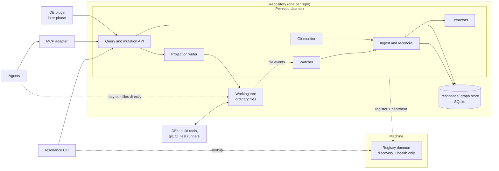

## 7. Architecture overview

### 7.1 Components

| Component | Responsibility | Status |
| --- | --- | --- |
| **Graph store** | Holds all graph data for one repository, in a structured binary store (SQLite) inside the repo. | [Decided] as the starting point |
| **Working tree** | Ordinary files, used by every unaware tool. A replica of the file content held in the graph. | [Decided] no mount; [Proposed] replica framing |
| **Per-repo daemon** | Single owner of the repo's graph: watcher, ingest, projection writer, git monitor and API in one process. | [Decided] persistent watcher; [Proposed] co-location |
| **Watcher** | Receives OS file events for the working tree. | [Decided] |
| **Ingest and reconcile** | Turns file changes into graph updates; maintains identity across edits. | [Proposed] |
| **Extractors** | Language plugins that derive code units and references from file text. | [Proposed] |
| **Projection writer** | Writes graph-originated changes to the working tree. | [Proposed] |
| **Git monitor** | Detects checkouts, rebases, merges and pulls; switches the daemon into bulk-reconcile mode. | [Proposed] |
| **Query and mutation API** | The separate API through which all graph-only information is reached. | [Decided] separate API; [Proposed] shape |
| **Registry daemon** | System-wide; answers "which endpoint serves this directory" and monitors daemon health. Nothing else. | [Decided] |
| **Clients** | CLI, MCP adapter for agents, IDE plugin later. | [Proposed] |

### 7.2 Principles

- **P1 — Single writer per repository.** Exactly one daemon owns a repository's graph and serializes every change, whether it comes from disk or from the API. [Proposed]
- **P2 — Unaware tools see only files.** Nothing about Resonance is visible in the working tree except the `.resonance/` directory. [Decided]
- **P3 — Never refuse a text write.** A file saved to disk is always accepted, even if it does not parse. Structure catches up. [Proposed]
- **P4 — Absence means delay, not error.** If the daemon is down, clients wait or start it; they never receive answers from an index that does not match the disk. [Proposed]
- **P5 — The registry is never on the request path.** [Proposed]
