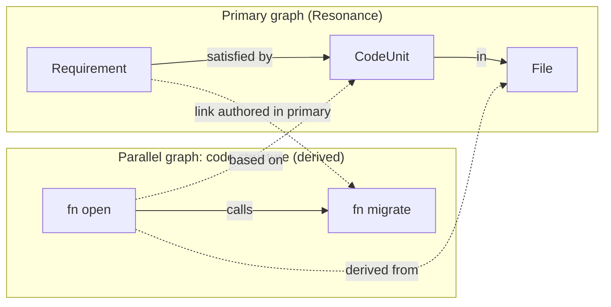

## 6. Conceptual model

### 6.1 Layers  [Proposed]

The graph is divided into layers by where information comes from, because origin determines how it is stored, versioned and trusted.

| Layer | Contents | Origin | Versioned in git? |
| --- | --- | --- | --- |
| **Intent** | Requirements, decisions, designs, constraints, and the milestones requirements are planned for | Authored by people and agents | Yes |
| **Realization** | Files (as content); code units (named regions of file content) | Files: authored as text. Code units: declared by people and agents; their current positions are tracked from the text | Files: yes, as ordinary files. Code units: yes (identity and anchors); positions recomputed |
| **Verification** | Tests (code units with a way to run them), test runs, evidence records | Tests: declared by people and agents. Evidence: recorded from execution | Evidence summaries: [Open] (OQ-09) |
| **Annotation** | Notes, call-outs, constraints on specific code units | Authored | Yes |
| **Identity** | Stable IDs and their history (renames, moves, splits, merges) | Recorded by reconciliation and by people | Yes |

"Versioned in git" assumes the repository has reached adoption stage 2 or later (§8.16). In offline mode (§8.17) nothing is committed: the same layers are kept locally, with the same structure, so that sharing later is a move and not a conversion.

### 6.2 Core node types  [Proposed]

Keep the core small. Everything else goes through namespaced extensions (§6.6).

| Type | Purpose | Key properties |
| --- | --- | --- |
| `Requirement` | A statement of required behavior or quality | `key` (e.g. `FR-042`), `text`, `kind` (functional, non-functional), `status` (draft, active, superseded, retired). No priority: a requirement is satisfied or not, and when it is to be satisfied is its milestone (§8.24) |
| `Decision` | A recorded choice and its rationale (ADR-like) | `title`, `context`, `decision`, `consequences`, `status` |
| `Design` | A design element: component, interface, flow | `title`, `description` |
| `Constraint` | A rule code must obey (performance, compatibility, policy) | `text`, `scope` |
| `Milestone` | A stage of the project that requirements are planned for (§8.24) | `key` (e.g. `M1`, `v0.3`), `title`, `description`, `targetDate` (optional), `order`, `status` (planned, current, done, retired) |
| `File` | A file in the working tree | `path`, `blob` (content hash), `language` |
| `CodeUnit` | A named region of a file's content, such as a function or type as a person or agent sees it. Declared by a person or agent; Resonance does not parse code to find it (§2.5) | `name`, `kind` (free text: function, type, test, block…), `file`, `anchor` (byte range plus quoted text and surrounding context, §8.3) |
| `Test` | A test case (a `CodeUnit` specialization) | `run` (how to run it alone), `framework` (optional) |
| `Evidence` | The outcome of a check, such as a test run | `kind`, `result`, `commit`, `timestamp`, `toolVersion` |
| `Annotation` | A note or call-out from a person or agent | `text`, `kind` (note, warning, call-out, instruction), `author` |
| `Conflict` | An unresolved semantic conflict found during a merge | `ops`, `description` |

### 6.3 Core edge types  [Proposed]

| Edge | From → To | Meaning | Checkable by execution? |
| --- | --- | --- | --- |
| `satisfies` | CodeUnit → Requirement | This code implements (part of) the requirement | Indirectly, through tests that verify both |
| `verifies` | Test → Requirement or CodeUnit | This test checks the requirement or unit | Yes |
| `derivedFrom` | Requirement/Design → Requirement; any spec item → CodeUnit or File | Refinement or decomposition; or, to a region of a document, the text an agent imported the item from (FR-124) | No; becomes stale when either end changes |
| `constrains` | Decision/Constraint → any | This decision or constraint limits the target | Sometimes (for example, with architecture rules) |
| `supersedes` | Requirement/Decision → same type | Replaces an earlier version | No |
| `realizes` | CodeUnit → Design | This code is the current realization of a design element | No |
| `plannedFor` | Requirement → Milestone | The requirement is to be satisfied by this milestone; at most one per requirement (§8.24) | No |
| `annotates` | Annotation → any | Attaches an annotation | No |
| `contains` | File/CodeUnit → CodeUnit | Containment of one region in another | Derived from anchor ranges |
| `references` | CodeUnit → CodeUnit | Calls, uses, imports, inherits | Never in the primary graph; only in a parallel code-structure graph (§6.7, FR-112) |
| `evidences` | Evidence → edge or node | This evidence supports a link or node status | — |

Every edge carries: `provenance` (human, agent, derived, imported), `author`, `createdAt`, `confidence` (for agent-created links), `status` (§6.5), and optional `evidence` references.

Most Edges have a reversed direction counter-part for reverse queries. The counter part follows the "X-ed by" form of speech. For example: the reverse of a "contains" Edge would be "contained by". Visualizations of the graph should seek to exclude these reverse edges, while UI panels should allow showing both forward and backward relations for specific nodes to aid in discoverability.

### 6.4 Where stable identity belongs  [Proposed]

If agents increasingly regenerate code instead of editing it, code units become short-lived, and links pointing at them break whenever code is rewritten. The model therefore anchors **stable identity to intent**:

- Requirements, decisions, designs, constraints and tests carry **permanent IDs**.
- Code units are the **current realization** of intent. Their links to intent (`satisfies`, `realizes`) are recomputed or re-confirmed when code is regenerated.
- Annotations on code units still need identity reconciliation across edits (§8.3), because code-fluent developers annotate specific functions.

### 6.5 Link lifecycle  [Proposed]

```
asserted ──(evidence recorded)──▶ verified
    │                                 │
    │                (either endpoint changes after verification)
    │                                 ▼
    └──────────────────────────────▶ stale ──(re-verified)──▶ verified
                                      │
                         (an endpoint disappears)
                                      ▼
                                  orphaned
```

- **FR-001** Every edge MUST have exactly one status: `asserted`, `verified`, `stale` or `orphaned`.
- **FR-002** A change to the content of either endpoint of a `verified` edge MUST move it to `stale`.
- **FR-003** An edge whose endpoint is removed without an identity operation MUST become `orphaned`, not be deleted.
- **FR-004** `verifies` edges SHOULD be verified automatically by recording test results as `Evidence`.
- **FR-005** Queries MUST be able to filter by link status, so that "requirements with no verified test" is a single query.

### 6.7 Primary and parallel graphs  [Decided]

The graph Resonance stores is the **primary graph**: intent, files, code units, tests, evidence, annotations and their links. Other graphs MAY exist **in parallel** to it. A parallel graph is derived from, or based on, the primary graph; a code-structure graph built by a tool such as Mache from the file content that the primary graph holds is the motivating example.



- **Derived from the primary graph.** A parallel graph is built from primary data at a known version, and can be dropped and rebuilt without loss to the primary graph.
- **Links in both directions are allowed.** A parallel node may point at primary nodes, and a primary edge may point at a parallel node.
- **Queries are fair game.** Any read operation may traverse into parallel graphs and back.
- **Operations on a parallel graph cannot modify the primary graph.** Building, updating or editing a parallel graph never changes primary nodes, edges or file content. A person or agent who *reads* a parallel graph may still change the primary graph through the primary API, as themselves.
- **The one possible exception.** The restriction may be relaxed for a parallel graph only if its nodes carry enough information to make *exact* edits of primary nodes, so that an edit to a parallel node is guaranteed to translate soundly into a primary edit. Until a sufficiently powerful and well-integrated tool exists, every parallel graph is read-only with respect to the primary graph (FR-241).

**Disconnected graphs.** A parallel graph may also be **disconnected**: a stand-alone graph of useful semantic information, produced by an existing tool adapted to emit it, and loaded into Resonance with no links to any primary node. It needs no machinery beyond that of a parallel graph. The same read-only rule applies, and it can be queried on its own and alongside the primary graph. Disconnected graphs are the expected starting point for adapting existing tooling, before that tooling grows Resonance-native support. A tool climbs a ladder:

| Rung | The tool's graph… | What it must provide |
| --- | --- | --- |
| **Disconnected** | is loaded as a stand-alone parallel graph | Nodes and edges in Resonance's import format |
| **Connected** | links to primary nodes and is kept in step with the primary graph | References to primary nodes (files, code units), stable node IDs, the primary version it was built from |
| **Write-capable** | can translate its edits into primary edits | Enough information for exact edits of primary nodes (FR-241) |

People and agents can connect a disconnected graph themselves before its tool climbs. Authoring primary links to its nodes is ordinary primary work (FR-117).

Requirements are in §8.9.

### 6.6 Ontology governance  [Proposed]

- **FR-006** The core node and edge types in §6.2 and §6.3 MUST be versioned as a schema, with a schema version stored in the graph.
- **FR-007** Projects MAY define extension types in a namespace (for example `acme:Service`). Extensions MUST NOT change the meaning of core types.
- **FR-008** Unknown extension types MUST be preserved on read and write, even by versions of Resonance that do not understand them.
- Guiding rule: add a core type only when several real projects need the same meaning. Earlier semantic-desktop efforts collapsed partly under ontology complexity.
