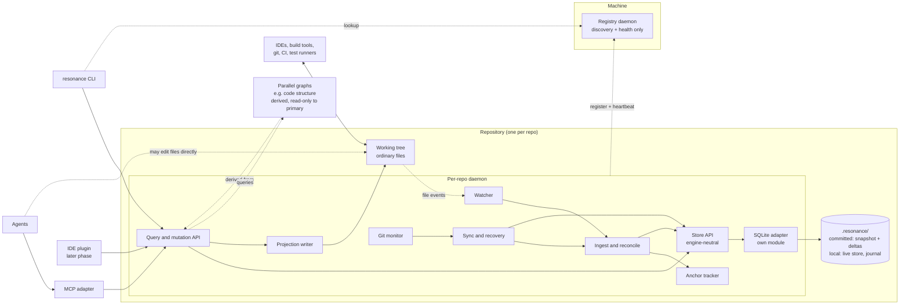

## 7. Architecture overview

### 7.1 Components

| Component | Responsibility | Status |
| --- | --- | --- |
| **Graph store** | Holds all graph data for one repository inside the repo: a committed snapshot plus delta files (§8.6.1) and a local live store. | [Decided] |
| **Store API** | Engine-neutral persistence interface (nodes, edges, operations, traversals, blobs, snapshots). The only way any other component touches storage. | [Decided] (§8.2.1) |
| **SQLite adapter** | The first implementation of the store API, in its own module; the only code that knows SQLite exists. Expected to be replaced by a graph engine adapter later. | [Decided] (§8.2.1) |
| **Working tree** | Ordinary files, used by every unaware tool. A replica of the file content held in the graph. | [Decided] no mount; [Proposed] replica framing |
| **Per-repo daemon** | Single owner of the repo's graph: watcher, ingest, projection writer, git monitor and API in one process. | [Decided] persistent watcher; [Proposed] co-location |
| **Watcher** | Receives OS file events for the working tree. | [Decided] |
| **Ingest and reconcile** | Turns file changes into graph updates; maintains identity across edits. | [Proposed] |
| **Parallel graphs** | Graphs derived from the primary graph by separate tools (for example a code-structure graph from Mache), or loaded stand-alone from existing tools as *disconnected* graphs. Linked both ways; queried freely; never able to modify the primary graph (§6.7, §8.9). | [Decided] in substance; [Open] storage (OQ-23) |
| **Anchor tracker** | Keeps code-unit anchors attached to the right text as files change, by diffing and text matching; no parsing (§8.3). | [Proposed] |
| **Projection writer** | Writes graph-originated changes to the working tree. | [Proposed] |
| **Git monitor** | Detects checkouts, rebases, merges and pulls; switches the daemon into bulk-reconcile mode. | [Proposed] |
| **Sync and recovery** | Classifies every disagreement between git, the working tree and the graph using git evidence; applies authority rules; keeps the recovery journal; produces user-facing explanations (§8.18, §8.19). | [Decided] in substance; [Proposed] shape |
| **Query and mutation API** | The separate API through which all graph-only information is reached. | [Decided] separate API; [Proposed] shape |
| **Registry daemon** | System-wide; answers "which endpoint serves this directory" and monitors daemon health. Nothing else. | [Decided] |
| **Clients** | The MCP adapter, through which agents do all graph work (G16); the spec TUI for people (§8.22, deliberately simple, the fallback); the web UI, served by the daemon, for richer interaction, diagnostics and logs (§8.23); the operations CLI for setup, daemon control, status, checks and repair (FR-259); and later the JetBrains plugin, the intended primary interactive surface for people (FR-141), then a Nimbalyst extension (FR-143), on the same API. | [Decided] TUI, web UI and JetBrains; [Proposed] Nimbalyst, shape |
| **Agent kit** | Instructions, a skill and harness hooks installed into each developer's agent during onboarding, plus conventions served live by the MCP adapter. Makes the agent the first line of enforcement (§8.20). | [Decided] in substance; [Proposed] shape |

**One binary** [Decided]: every component above that runs on a developer's or CI machine ships in the single `resonance` executable, as subcommands (§11). Packaging and distribution are in §13.

**Implementation language** [Decided]: Rust, for every component (daemon, CLI, MCP adapter, store adapters, anchor tracker), organized as a Cargo workspace. Resolves OQ-11. Rust gives small, fast, single-binary daemons and CLIs with no runtime to install; this matters for per-repository daemons (FR-085) and for the locally fetched quiet CLI (FR-231).

### 7.2 Principles

- **P1 — Single writer per repository.** Exactly one daemon owns a repository's graph and serializes every change, whether it comes from disk or from the API. [Proposed]
- **P2 — Unaware tools see only files.** Nothing about Resonance is visible in the working tree except the `.resonance/` directory. [Decided]
- **P3 — Never refuse a text write.** A file saved to disk is always accepted, whatever its content. Anchors catch up. [Proposed]
- **P4 — Absence means delay, not error.** If the daemon is down, clients wait or start it; they never receive answers from an index that does not match the disk. [Proposed]
- **P5 — The registry is never on the request path.** [Proposed]
- **P6 — Explicit authority.** Opting in makes the graph the developer's source of truth. For every file, at every moment, Resonance can say whether it governs that file (path scope) and where a given change came from: from a Resonance user, and therefore consistent with the graph, or from outside Resonance through git, and therefore to be absorbed (§8.16, §8.18). [Decided]
- **P7 — Never destroy, always explain.** Resonance acts automatically only when nothing is lost. Whatever a resolution displaces is preserved and can be restored, and every non-trivial event is explained in terms the developer already knows: git operations, commits, files (§8.18, §8.19). [Decided in substance]
- **P8 — Engine behind an API.** No component other than the storage adapter knows which database engine is in use (§8.2.1). [Decided]
- **P9 — Agents enforce, Resonance checks, hooks back up.** Onboarding Resonance includes onboarding the agent. The agent keeps the graph and the git tree in sync, and keeps PRs clean, by running Resonance's deterministic checks at the right moments. Hooks and CI catch what agents miss (§8.20). [Decided]
- **P10 — The primary graph is sovereign.** Parallel graphs are derived from it, may link to it and be queried alongside it, but nothing done to a parallel graph changes it, unless the parallel graph can prove exact edits (FR-241). [Decided]
