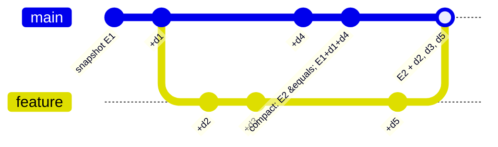
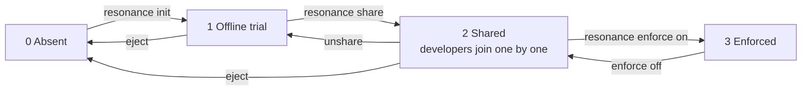

## 8. Detailed design

### 8.1 Source-of-truth semantics

"Graph as source of truth" means the graph store is authoritative for everything, including file content, while the working tree is a replica that tools can use directly.

That is the end state for a whole team, and it is reached one developer at a time (§8.16). **A developer who joins a repository's shared graph has opted in, and from that moment the graph is their source of truth, including for file bytes.** All of their operations (edits, commits, merges, rebases, pushes) must stay consistent with the graph, and their agent does most of the work of keeping it so (§8.20). For developers who have not opted in, git remains the source of truth for their own work. That includes developers trying Resonance in offline mode, whose private graph is derived from git history and the file tree (§8.17). Their commits reach the graph through ingest, and files arriving that way are taken seriously and never silently discarded (§8.18). Graph-only data (intent, links, annotations, identity) is authoritative in the graph at every stage. [Decided]

- **FR-010** The graph MUST hold the exact content of every tracked file, stored as content-addressed blobs, at every adoption stage. For every developer who has opted in, the graph's content is authoritative for bytes (FR-203). For an offline trial user, git and the file tree are the input, and the graph follows them (§8.17). Changes made by developers who do not run Resonance reach the graph through ingest (§8.18). Path scoping may limit which files Resonance governs at all (FR-178). [Decided in substance]
- **FR-011** The positions of code-unit anchors, and containment derived from them, MUST be recomputable from file content plus the recorded anchors, and MUST NOT be the only record of anything a person or agent authored. [Proposed]
- **FR-012a** A file change on disk MUST update the graph's copy of that file whatever its content. Resonance never needs to understand a file to store it. [Proposed]
- **FR-012b** File changes that occur while the daemon is not running MUST be detected at start-up (FR-047) and classified (§8.18) before anything is written. Changes that a git operation explains (checkout, pull, reset and so on) are applied to the graph as git-originated. For a developer who has opted in, Resonance is their source of truth (§8.16), so any remaining unexplained change is a *conflict* that is surfaced to the user. The file is restored from the graph, the disk version is preserved in the recovery journal (FR-192), and the user, usually through their agent, is asked whether to merge, keep the disk version, discard it, or take other action. In offline mode, where the graph follows the file tree, such changes are simply ingested (FR-188). [Decided: such changes become conflicts that the user resolves. Proposed: classify first, and preserve the disk version in `.resonance/local/recovery/` rather than renaming it in the source tree; see T9.]
- **FR-013** Resonance parses only files it interprets itself: its own configuration and data, and git configuration. It never parses intent documents (NG6) or source code. Source code is never parsed (NG4). When such a file does not parse, what was derived from it MUST be marked stale, and links and annotations on it MUST be kept. This should be an exception circumstance as there is no particular parsing of user files that is required. Unparseable git files must result in a message to the user. The `doctor` command should revert unparseable core files (like git configs, etc) to their known good graph counterparts. [Proposed]
- **FR-014** The working tree MUST be a standard software project for the project's language and build system. [Decided]
- **FR-015** All graph-only information (intent, links, annotations, evidence, identity history) MUST be reachable only through the API, never as extra files mixed into the source tree. Projected intent documents (§8.10) are the one deliberate exception, and are opt-in. This is solely because tooling has yet to be built that would move these intent documents entirely into the graph. Nevertheless, real projects will have a split of graph-native and file-native intent documents. [Decided, with the exception Proposed]

Rationale: storing file text in the graph and treating it as authoritative for bytes avoids the lossless round-trip problem of printing files from syntax trees (comments, whitespace, formatting), and it means Resonance never needs to understand the code it stores. If a language later chooses to store its source in Resonance in another format (G15), that format and its rendering to text are the language's responsibility; a lossless tree that keeps trivia (as Roslyn and rust-analyzer's `rowan` do) is the likely shape. (No programming language in wide-spread usage is yet graph-native; resonance is a key step in enabling that future.) [Proposed]

### 8.2 Storage

- **FR-020** The graph store MUST be a structured binary store kept in the repository alongside regular files. SQLite is the assumed starting choice, behind the store API (§8.2.1). In offline mode the store lives in the same place but is not committed (§8.17). [Decided: structured blob in the repo; SQLite as the starting engine]
- **FR-021** The store MUST live under `.resonance/` at the repository root. [Decided]
- **FR-022** The store MUST be crash-safe: every applied change is a transaction. [Decided]
- **FR-023** The store MUST separate authored, identity and derived data so that derived data can be dropped and rebuilt without loss. [Decided]
- **FR-024** Derived data SHOULD be cached keyed by the content hash of its inputs, so that switching back to a previously seen tree state is fast. [Proposed]
- **FR-025** Local-only runtime files (live store, journal, recovery copies, endpoint file, lock file, sockets, caches) MUST be excluded from git. [Decided] `resonance init` and `resonance share` MUST achieve this without modifying any existing tracked file. In offline mode they add `.resonance/` to `.git/info/exclude`, which is local to the clone; from stage 2 onward they create `.resonance/.gitignore`, which ignores `.resonance/local/`. [Proposed; changes the mechanism from editing the root `.gitignore`, see T11]
- **FR-026** Committing `graph.db` on every change would fill git history with large binary blobs. Resonance therefore commits a **snapshot** (`graph.db`) plus an add-only **sequence of small delta files** that record changes made since the snapshot. Deltas accumulate on whatever branch the work happens on: fork `main` into a branch, and the branch accumulates its own deltas. Every N deltas (configurable), they are **compacted** back into a new snapshot so that they do not build up. This is the only accommodation the store makes for git (FR-072). Details in §8.6.1 and §9.6. [Decided: snapshot plus deltas, compacted every N. Proposed: details]

Illustrative layout [Proposed]:

```
.resonance/
  graph.db            # committed snapshot: authored + identity data as of the last compaction (an "epoch"); immutable between compactions (FR-074)
  deltas/             # committed, add-only delta files written since the snapshot (§8.6.1)
    01JA4…Q3.delta    #   sealed: already committed, never modified again
    01JB9…7K.delta    #   open: still being written; goes into the developer's next commit
  config.toml         # project configuration, including the repository's adoption stage (committed)
  README.md           # plain-language note for teammates who do not use Resonance (FR-174)
  .gitignore          # ignores local/ (stage 2+, FR-025)
  .gitattributes      # graph.db binary with optional merge driver; optional textconv for deltas (FR-079)
  local/              # never committed
    state.db          # live working store: snapshot + deltas + derived data + uncommitted state
    journal/          # every operation applied or written, independent of the working tree (FR-194)
    recovery/         # versions displaced by conflict resolution (FR-192)
    backups/          # optional local backups, mainly for offline mode (FR-184)
    cache/            # derived-data cache keyed by tree hash
    daemon.lock       # single-instance lock
    daemon.json       # endpoint, pid, versions
```

In offline mode the layout is the same, but `README.md`, `.gitignore` and `.gitattributes` are not created, and the whole directory is excluded through `.git/info/exclude`.

Illustrative core tables. These are an internal detail of the SQLite adapter (FR-161), not part of any interface [Proposed]:

| Table | Columns (sketch) |
| --- | --- |
| `nodes` | `id`, `type`, `props` (JSON), `layer`, `created_op`, `retired_op` |
| `edges` | `id`, `type`, `src`, `dst`, `props`, `status`, `provenance`, `confidence`, `created_op`, `removed_op` |
| `blobs` | `hash`, `bytes`, `size` |
| `files` | `path`, `blob`, `generation`, `last_ingested_at`, `parse_state`, `authority` |
| `anchors` | `code_unit`, `file`, `start_byte`, `end_byte`, `quote_hash`, `quote`, `prefix`, `suffix`, `confidence` |
| `ops` | `op_id`, `kind`, `payload`, `actor`, `hlc`, `change_set`, `delta`, `commit` |
| `deltas` | `delta_id`, `state` (open, sealed, folded), `commit`, `epoch`, `manifest` |
| `identity` | `id`, `lineage` (previous IDs), `op` |
| `recovery` | `id`, `path`, `classification`, `displaced_blob`, `kept_blob`, `evidence`, `created_at`, `undone_at` |
| `meta` | `schema_version`, `store_format`, `epoch`, `repo_root`, `stage`, `participation`, `last_reconciled_commit`, `ingest_watermark` |

SQLite with recursive common table expressions is expected to handle the traversal depths Resonance needs (one to a few hops) for now. SQLite is not the intended long-term engine; choosing a graph engine is [Open] (OQ-03), and the boundary in §8.2.1 exists so that the choice can be made late and changed.

### 8.2.1 Storage engine encapsulation

SQLite is the starting engine because it is embedded, robust, ubiquitous and good enough for one-to-few-hop traversals. It is a stepping stone. Once a suitable graph engine has been researched (OQ-03, G11), Resonance is expected to build on it. Everything engine-specific is therefore isolated so that the move touches one module. [Decided]

- **FR-160** All persistence MUST go through a single **store API** defined in engine-neutral graph terms: nodes, edges, properties, content-addressed blobs, operations and change sets, and bounded traversals. SQLite is one implementation of it, the **SQLite adapter**. [Decided]
- **FR-161** The SQLite adapter MUST live in its own module (crate or package) and be the only code that depends on SQLite. SQL text, SQLite types, row IDs, table names and SQLite error types MUST NOT appear in the store API or reach callers. A build-time dependency check SHOULD enforce this. [Decided in substance; Proposed: enforcement]
- **FR-162** The store API MUST cover at least: transactions (atomic application of a change set, FR-022); reads and writes of nodes, edges and properties; bounded traversals (neighbors, paths, depth-limited expansion filtered by type and status); blob put and get; metadata such as the ingest watermark and stage; a change feed (FR-104); snapshot export and import (FR-074); delta application; an integrity check (for `resonance doctor`); and schema migration. [Proposed]
- **FR-163** Higher-level operations (`trace`, `why`, impact, context packs, divergence classification) MUST be written against the store API, not against the engine. An adapter MAY provide optimized implementations of specific traversals as optional capabilities, with a generic fallback above the API. [Proposed]
- **FR-164** The committed delta format MUST be engine-neutral: it serializes edit-algebra operations (§9), not SQLite pages, rows or a SQLite file. Deltas written by one engine MUST be readable by any other. [Proposed; follows from FR-160; see T14]
- **FR-165** The snapshot format is owned by the adapter and MUST carry a format identifier and version. A change of engine or format MUST be possible through a **migration compaction**: fold the current snapshot and deltas through the old adapter, and write the new snapshot through the new one. Delta files and git history need no rewriting (S21). [Proposed]
- **FR-166** The store MUST support a complete engine-neutral export and import of authored and identity data as edit-algebra operations. This is the format of last resort for engine migration, backups, `resonance share` (FR-185) and `resonance eject` (FR-173). [Proposed]
- **FR-167** A conformance test suite MUST define the store API's behavior, and every adapter MUST pass it. A second, minimal adapter (for example in-memory) SHOULD exist from the start, to keep the boundary honest and to speed up tests. [Proposed]
- **FR-168** Engine-specific escape hatches, such as read-only SQL over documented views (FR-105) or direct read-only access to the store file (FR-081), MAY be offered only as explicitly engine-specific, unstable capabilities. They MUST NOT be part of the stable API, and MUST NOT be used by Resonance's own higher-level code. [Proposed; see T12]
- **FR-169** The committed snapshot MUST never be the live store. The daemon reads it to build `.resonance/local/state.db` and writes a new one only during compaction, so that git checkouts, merges and stashes can replace `graph.db` safely at any moment without corrupting an open database. [Proposed]

### 8.3 Identity and reconciliation

This component determines whether annotations and links survive real editing. It SHOULD be built and tested first, against real editing histories. [Proposed] Code units are anchors on text, not parsed symbols (§2.5), so reconciliation is purely textual. Whenever meaning is needed, it comes from the agent. [Decided in substance]

- **FR-030** Authored nodes (requirements, decisions, annotations, and so on) MUST receive a permanent, globally unique ID when created (for example UUIDv7 or ULID). [Proposed]
- **FR-031** Every clone of a repository MUST agree on the IDs of nodes that authored data refers to. Code units are authored nodes with permanent IDs (FR-030), so agreement comes from committing their creation and every re-anchoring decision as operations. [Proposed]
- **FR-032** After each change to a file, the daemon MUST re-locate every code-unit anchor in it, and carry IDs, links and annotations across. Locating proceeds in order:
  1. Map the previous range through the text diff between the old and new content.
  2. If the anchored text was deleted or rewritten, search the file for the quoted text, using the surrounding context to disambiguate.
  3. Search other changed files for it (a move).
  4. Accept an approximate match of quote and context above a threshold, with its confidence recorded.
  5. Otherwise orphan the anchor (FR-034).

  No parsing is involved. [Proposed]
- **FR-033** When the daemon re-anchors a code unit to another file, or to text it matched only approximately, and authored data depends on it, it MUST record that decision as an identity operation (§9.4), so that other clones apply the same judgment rather than recomputing it differently. Splits and merges are declared by people or agents through the API. [Proposed]
- **FR-034** When matching fails, affected links and annotations MUST become `orphaned` with a record of the last known location. They MUST NOT be deleted. [Proposed]
- **FR-035** File identity MUST be path-based. An editor that saves by writing a temporary file and renaming it over the original MUST be treated as a new version of the same file node. [Proposed]
- **FR-036** Real file moves MUST be detected by content similarity, as git does, and recorded as identity operations. [Proposed]
- **FR-037** People and agents MUST be able to correct a reconciliation decision (for example, re-attach an orphaned annotation) through the API. [Proposed]
- **FR-038** When a region is rewritten beyond textual recognition, deciding what it now corresponds to is a semantic judgment, and it belongs to the agent. Such code units, and approximate matches below a confidence threshold, go on the repair list. The agent, which understands the code, re-anchors, splits, merges or retires them through the API (FR-037, FR-238). [Proposed]

### 8.4 Watcher and ingest

- **FR-040** Each repository MUST have a persistent watcher process for its working tree. [Decided]
- **FR-041** The watcher MUST use native file-event APIs: FSEvents on macOS and inotify (or fanotify) on Linux. Windows support is [Open] (OQ-07). [Proposed]
- **FR-042** The watcher MUST tolerate batched, coalesced, delayed and out-of-order events. FSEvents reports at directory granularity and merges changes, so the watcher MUST re-examine affected paths (hash comparison) rather than trust event contents. [Proposed]
- **FR-043** The daemon MUST maintain an **ingest watermark**: the point up to which disk changes have been applied to the graph. [Proposed]
- **FR-044** The daemon MUST suppress events caused by its own writes, by recording the path, content hash and generation of every file it writes and ignoring a matching event. [Proposed]
- **FR-045** The watcher MUST ignore, by default: `.git/` internals (handled by the git monitor, §8.6), everything under `.resonance/` (`local/` is private to the daemon; the committed snapshot and deltas are watched by the git monitor and the sync logic, §8.6.1 and §8.18, not ingested as project content), and editor scratch files (for example `*.swp`, `*~`, `.#*`, vim's `4913` probe file). [Proposed]
- **FR-046** Generated and build-output directories MUST NOT be ingested as graph content. Defaults include `target/`, `.bsp/`, `.bloop/`, `.metals/`, `build/`, `dist/`, `out/`, `.gradle/`, `node_modules/`, `.venv/`, `__pycache__/`. The watcher SHOULD also respect `.gitignore`. Mache's experience (a watcher on `target/` leaking roughly 129,000 file descriptors) shows why this matters. [Proposed]
- **FR-047** On startup, the daemon MUST reconcile the graph against the disk before serving queries, using content hashes. It MAY use FSEvents' replay-since-event-ID as an optimization, but MUST fall back to a full hash scan because that history is advisory. The order of catch-up and the classification of each difference follow FR-195. [Proposed]
- **FR-048** A burst of changes that matches a git operation MUST be handed to the git monitor instead of being processed as individual edits (§8.6). [Proposed]
- **FR-049** Ingest of a changed file MUST be incremental: re-hash, update the blob, re-locate the anchors in that file, update link statuses. [Proposed]

### 8.5 Projection writer (graph → disk)

- **FR-050** When a graph mutation changes file content, the daemon MUST write the file with an atomic replace (write a temporary file in the same directory, then rename), preserving permissions and line endings. [Proposed]
- **FR-051** Writes MUST produce ordinary file-system events, so IDEs, build tools and test watchers notice them with no special integration. [Decided in substance: G5]
- **FR-052** Before writing, the daemon MUST check that the file on disk still matches the version the mutation was based on (by hash or generation). If it does not, the daemon MUST ingest the disk version first and then re-evaluate the mutation. [Proposed]
- **FR-053** Conflict policy: an edit made on disk by a person takes precedence. A graph mutation that no longer applies cleanly MUST be rejected with a conflict error or rebased by the caller, never silently overwrite the disk. [Proposed]
- **FR-054** Multi-file mutations SHOULD be written as a batch, to keep event bursts short and to avoid build tools seeing a half-applied change for long. [Proposed]

### 8.6 Git integration

Git integration was identified as the next significant problem. This section records the compatibility stance, the decided constraints, the committed-data design and the handling of git operations.

**Compatibility stance** [Decided]

"Git compatible" means that every team that onboards Resonance already uses git, and **will keep using git, for everything, while it tries and adopts Resonance**. That includes Resonance's own development: Mark and Claude develop Resonance in git, and Resonance's repository will adopt Resonance through the same stages as any other project. So Resonance must fit into an ordinary git workflow at every adoption stage (§8.16), including for teammates who never install it. It does **not** mean shaping the graph store to suit git. A SQLite database is about as git-friendly as the store will get, with one exception: changes are committed as a sequence of delta files, which are compacted back into the database every N deltas.

- **FR-071** Resonance MUST work within an ordinary git workflow (branch, commit, merge, rebase, cherry-pick, revert, stash, pull request on any host) at every adoption stage, without requiring teammates to install Resonance or change how they use git. Resonance's own repository MUST be developed this way, and MUST adopt Resonance through the same stages as any other project. [Decided]
- **FR-072** The graph store's data model MUST NOT be compromised to make it more git-friendly. The only git-motivated accommodation is the layout of committed data: a snapshot plus add-only delta files that are periodically compacted back into it (FR-026, §8.6.1). Line-oriented text formats, one-file-per-node layouts and similar restructurings for the sake of git diffs or merges are out of scope (NG5). [Decided]

**Decided constraints**

- **FR-060** The graph store's internal representation MUST be optimized for the system's access patterns and need not be textual. [Decided]
- **FR-061** All changes MUST be expressible in an edit algebra of textual edits and node-centric edits that git can carry and merge (§9). [Decided]

**Proposed approach**

- **FR-062** The **derived layer MUST NOT be committed**. It is rebuilt from source files (or fetched from a cache keyed by tree hash). [Proposed]
- **FR-063** From stage 2 onward, the **authored and identity layers MUST be versioned** in git, as the snapshot and deltas of §8.6.1. In offline mode they are kept locally with the same structure (§8.17). [Proposed]
- **FR-064** For as long as files remain in git (OQ-19), file content is versioned by git as ordinary files. Text edits MUST NOT be duplicated as committed content. A delta records only a **file manifest**: the content hashes of files whose changes Resonance saw or made while the delta was open (FR-075). That is enough to detect when git and the graph disagree (§8.18). The exception is a text edit that changes identity (FR-033), which is recorded as an identity operation. [Proposed]
- **FR-065** Authored and identity changes MUST merge without manual resolution in the common case, and genuine conflicts MUST become `Conflict` nodes (S11). [Proposed]
- **FR-066** Graph changes in a pull request SHOULD be reviewable. Because the committed formats are not shaped for git (FR-072), reviewability comes from tooling rather than from the format: a textconv diff driver for delta files (`resonance git-driver textconv`), a review summary of a range (MCP `resonance_review`) that the agent puts in the pull request description, and an optional CI step that posts that summary on the pull request. [Proposed; revised to follow FR-072, see T10]

**How authored data is committed** [Decided: snapshot plus deltas (FR-026). Resolves OQ-01.]

| Option | Description | Strengths | Weaknesses |
| --- | --- | --- | --- |
| **D. Snapshot plus delta log** (chosen) | A SQLite snapshot (`graph.db`) plus add-only, uniquely named delta files of edit-algebra operations, compacted back into a new snapshot every N deltas (§8.6.1). | The store keeps its natural form. Few large blobs enter git (one per compaction rather than per commit). Deltas never conflict, so branches merge with git's merge button. Deltas are engine-neutral, so they survive compaction and engine changes. | Needs compaction rules and a mechanical repair for colliding compactions (FR-155, FR-157). PR review needs tooling (FR-066). |
| A. Operation-log files only | Every change set is a new ops file; the graph is a fold over all of them. | Union merges; text-reviewable. | Unbounded number of files; slow folds; pushes the format toward git's needs. Survives inside D as the delta log. |
| B. Custom git refs | Operations stored as git objects under a separate ref namespace, as git-bug and Gerrit NoteDb do. | Keeps the working tree clean; native git storage. | Refs are not pushed or fetched by default, are invisible to hosting UIs and hold-outs, and must be tied to code commits explicitly. Rejected. |
| C. Commit the SQLite file on every change | The database file itself is committed every time. | Simplest. | A new binary blob in every commit; every concurrent change conflicts. Survives inside D only as the snapshot, which is rewritten once per compaction. |

### 8.6.1 Snapshot and delta log



The feature branch accumulates its own deltas (d2, d3, d5). Meanwhile `main` compacts d1 and d4 into a new snapshot E2 and deletes those delta files. When the branch merges, git takes `main`'s `graph.db` (only one side changed it) and `main`'s deletion of d1 (the other side never modified it), and adds the branch's new delta files. No conflicts arise. The resulting graph is E2 with d2, d3 and d5 applied on top, which is correct because deltas are semantic operations rather than patches against a particular snapshot.

- **FR-073** Committed authored and identity data MUST consist of exactly one snapshot (`.resonance/graph.db`) and zero or more delta files (`.resonance/deltas/*.delta`). The graph at any commit is the snapshot with every delta present at that commit applied in fold order (FR-151). [Decided in substance (FR-026); Proposed: details]
- **FR-074** The snapshot contains authored and identity data only. It never contains derived data, and it contains file content only after files leave git (OQ-19). It MUST be written in a canonical, compact form (no WAL or journal files, fixed page size, deterministic insertion order) and MUST carry a header recording format and version, schema version, epoch, and the IDs of every delta folded into it. It is immutable between compactions (FR-169). [Proposed]
- **FR-075** A delta file MUST contain: a header (delta ID, format version, schema version, writer and Resonance version, the epoch it was written against, and the branch it was started on, the last two for information only); a body of edit-algebra operations in canonical serialization (FR-153), each with its `opId`; and a file manifest (path → previous and new content hash) for files whose changes Resonance observed or made while the delta was open. The serialization format is [Open] (OQ-02) and is chosen for fidelity and size, not for git diffs (FR-072). [Proposed]
- **FR-076** Delta files MUST be named by a globally unique, time-sortable ID (for example `<ulid>.delta`), so that files written on different branches or machines can never collide. Once sealed, a delta file MUST never be modified. Deltas therefore only ever appear or disappear in git, and never conflict. [Proposed]
- **FR-077** Each working tree has at most one **open delta**, which receives operations as they happen and is rewritten atomically (temporary file, then rename), so that `git add` always stages a consistent version. When the git monitor sees a commit that contains the open delta, that delta is **sealed**. If the commit contains an earlier version of the file than the daemon has written, the committed version is what is sealed, and the remaining operations move to a new open delta. A developer who commits code without the open delta loses nothing: it stays open and goes into a later commit. Committing with plain `git add -A && git commit` MUST be enough; no Resonance command is required. [Proposed]
- **FR-078** Deltas MUST accumulate on whatever branch the work happens on. A merge is a union of the delta files of both sides, a rebase or cherry-pick carries delta files along like any other file, and a squash merge brings all of a branch's deltas into one commit. Because operations are idempotent by `opId` (FR-193), a delta that arrives twice (cherry-pick followed by merge, a stash popped after the operations were re-written) is harmless. [Proposed]
- **FR-079** From stage 2 onward, Resonance MUST place a `.gitattributes` inside `.resonance/` (never by editing the repository root's) that marks `graph.db` as binary and names an optional merge driver (FR-157), and a `README.md` explaining in plain language what the directory is and what a teammate without Resonance should do if git ever reports a conflict in it ("take either side; a Resonance user will repair it"). [Proposed]

**Git operation handling**

- **FR-067** The git monitor MUST watch `.git/HEAD`, refs, `index.lock`, `MERGE_HEAD`, and rebase state directories, and MUST suspend per-event ingest while a git operation is in progress. [Proposed]
- **FR-068** After a git operation completes, the daemon MUST rebuild state for the new commit. It loads or rebuilds the derived layer for the new tree; loads the snapshot and applies the delta files present at that commit (in offline mode, the local deltas associated with its ancestors, FR-183); classifies and ingests file changes that the operation brought in (§8.18); then applies uncommitted working-tree changes and the open delta. The graph state is a function of **commit plus uncommitted changes**. [Proposed]
- **FR-069** Onboarding MUST install git hooks for every Resonance user: `pre-commit`, to flush the open delta (FR-077) and check that the commit is consistent with the graph; `pre-push`, to check outgoing commits; and `post-checkout` / `post-merge` / `post-rewrite`, to notify the daemon promptly. The `pre-commit` and `pre-push` checks MAY block (FR-203). Hooks are never installed for hold-outs, and quiet participants get only non-blocking helpers (FR-232). The git monitor alone MUST remain sufficient for correctness; hooks add promptness and gating. Hooks MUST be chained with existing hooks and hook managers, never replace them (FR-177). [Decided in substance; Proposed: hook set]
- **FR-070** Each git worktree MUST be treated as a separate repository root with its own daemon and its own open delta. Whether worktrees share a derived-data cache is [Open] (OQ-08). [Proposed]

### 8.7 Process model: daemons, discovery and health

**Per-repository daemon**

- **FR-080** The watcher, ingest, projection writer, git monitor and query API for a repository MUST run under one owner (P1), because disk ingest and API mutations must be serialized against each other and self-write suppression requires knowing what the daemon wrote. [Proposed]
- **FR-081** Queries SHOULD be served by the same owner, so that they can honor read-your-writes (§8.8). Direct read-only access to the store file MAY be offered for tools that accept stale answers, but only as an engine-specific, unstable capability (FR-168). [Proposed]
- **FR-082** A daemon MUST take an exclusive lock on `.resonance/local/daemon.lock` at start. The lock, not the registry, guarantees one daemon per repository. [Proposed]
- **FR-083** A daemon MUST write `.resonance/local/daemon.json` with its endpoint, process ID, Resonance version, schema version and start time, so clients can find it without the registry. [Proposed]
- **FR-084** Clients MUST start a daemon on demand when none is running. Daemons SHOULD exit after a configurable idle period. [Proposed]
- **FR-085** The process layout MUST allow the per-repository component to run either as its own process or hosted alongside others in a shared process later, without design changes. (Originally motivated by a possible JVM implementation. Resonance is implemented in Rust (OQ-11), so per-process cost is small, but shared hosting stays possible.) [Proposed]

**Transport**

- **FR-086** Daemons MUST listen on Unix domain sockets by default, placed in a short per-user runtime directory (for example `~/.resonance/run/<hash-of-root>.sock`) because macOS limits socket paths to about 104 characters. [Proposed]
- **FR-087** If a TCP listener is ever enabled, it MUST bind to loopback only and require a per-daemon token, because an unauthenticated localhost service that accepts mutations is exposed to browser-based attacks such as DNS rebinding. [Proposed]

**Registry**

- **FR-088** A system-wide registry daemon MUST provide only (a) service discovery ("which endpoint serves this directory?") and (b) health monitoring of per-repository daemons. [Decided]
- **FR-089** The registry MUST NOT sit between a client and a repository daemon on any request. [Proposed]
- **FR-090** Daemons MUST register with a lease and renew it by heartbeat; entries that miss renewal expire. [Proposed]
- **FR-091** Registry entries MUST record: canonical repository root (symlinks resolved; each worktree separate), process ID, endpoint, Resonance version, schema version and start time, so version skew after upgrades is detectable. [Proposed]
- **FR-092** After a restart, the registry MUST rebuild its view by scanning known endpoint files and checking which locks are held. [Proposed]
- **FR-093** The registry SHOULD run under the platform's user service manager (launchd on macOS, `systemd --user` on Linux). [Proposed]
- **FR-094** In the first version the registry monitors only; it does not restart daemons. Supervision is a later decision. [Proposed]

**Health**

- **FR-095** Daemons MUST distinguish **liveness** (process responding) from **readiness** (graph current enough to serve), and report: state (starting, reconciling, ready, git-operation, degraded), ingest lag, pending event count, last successful ingest, and last error. Mache's experience of a daemon that answered its handshake while its graph build was stuck shows why readiness must be separate. [Proposed]
- **FR-096** `resonance doctor` MUST show all known daemons with their health and flag version skew, and MUST check adoption health as described in FR-207. [Proposed]

### 8.8 Query and mutation API

- **FR-100** All graph-only capabilities MUST be available through one API, used by the MCP adapter, the spec TUI and IDE plugins alike. The CLI uses the same API for setup, operation and repair, but does not expose graph work as commands (FR-259). [Decided in substance: G4, G16]
- **FR-101** The API transport SHOULD be JSON-RPC over the daemon's Unix socket. gRPC is an alternative. [Open] (OQ-04)
- **FR-102** Reads MUST offer read-your-writes: a query that follows a file save or a mutation MUST reflect it. The daemon achieves this by waiting for the ingest watermark to pass the relevant change, or by re-hashing the files a query touches. A client MAY request `consistency: cached` to skip the wait. [Proposed]
- **FR-103** Mutations MUST be submitted as batches of edit-algebra operations (§9) and applied atomically. [Proposed]
- **FR-104** The API MUST support subscriptions to change streams (for IDE plugins and agents). [Proposed]

Operation groups [Proposed]:

| Group | Examples |
| --- | --- |
| **Navigation** | `getNode`, `neighbors(node, edgeTypes, depth)`, `trace(requirement)` (forward), `why(codeUnit)` (backward), `path(a, b)` |
| **Search** | By text, by type, by key (`FR-042`), by status, by author or provenance |
| **Intent authoring** | Create, edit, supersede and retire requirements, decisions, designs and constraints |
| **Linking** | Add, remove and re-target edges; confirm or reject agent-suggested links |
| **Annotation** | Annotate, call out a set of code units for a task, list annotations for a scope |
| **Verification** | Record evidence; run the tests linked to a requirement; list unverified, stale or orphaned links |
| **Impact** | What is affected by changing this requirement, decision or code unit |
| **Context** | Build a context pack for an agent task (§8.11) |
| **Code mutation** | Replace a code unit's text, create files, move files (through the projection writer, §8.5) |
| **Diagnostics** | Health, ingest lag, reconciliation failures, conflicts |

- **FR-105** A general query language is [Open] (OQ-05). Proposed default: a fixed set of operations like those above, plus a read-only SQL escape hatch over documented views, offered only as an engine-specific, unstable capability that will change when the engine changes (FR-168). Cypher-like or Datalog-like languages can be added once real query needs are known.

### 8.9 Code structure and parallel graphs

Consistent with §2.5, Resonance core does not parse source code. Richer structure, if any, lives in parallel graphs (§6.7). This section records both boundaries.

**Core**

- **FR-110** Resonance core MUST NOT parse source code or depend on language-specific parsers. Code units and tests are declared by agents (and later by people in the IDE plugin) through the API. Resonance has no importers for source or intent documents (NG6). [Decided]
- **FR-111** The minimum structure Resonance provides is files, plus the code units and tests that agents declare (and, later, people in the IDE plugin), with their anchors. This is enough to anchor links and annotations, and it works for every text file in every language. [Decided in substance]
- **FR-112** Richer structure (modules, types, functions, and reference edges such as calls, uses and implements) MAY be supplied by a separate tool *as a parallel code-structure graph* (FR-115 onward), never as primary nodes. Mache is the obvious candidate; compiler-grade sources (SemanticDB, SCIP, language servers) are preferable to syntax-only parsing where available. Whether to build or integrate one is [Open]: Mark is not yet sold on it. [Decided: parallel, never primary. Open: whether to build]
- **FR-113** Further investment in structural queries MUST be justified by Phase 0 results (§12). [Decided in substance]
- **FR-114** Because core is language-agnostic, Resonance itself has no "first supported language": any text file can carry code units. Which languages a code-structure parallel graph would cover, if one is integrated, is [Open] (OQ-06). [Proposed]

**Parallel graphs**

- **FR-115** The graph Resonance stores is the **primary graph**. A **parallel graph** is a graph derived from, or based on, the primary graph, produced and maintained by a separate tool and identified by a name (for example `structure`). Its nodes and edges are distinct from primary nodes and edges, and every result says which graph each came from. [Decided]
- **FR-116** Operations on a parallel graph (building it, updating it, or editing its nodes and edges) MUST NOT modify the primary graph: no primary node, edge, property, anchor, file content or operation may be created, changed or removed by them. This MUST be enforced structurally, not by convention: a parallel graph's producer receives a write capability only for its own graph, and the store API rejects anything else. A person or agent who reads a parallel graph MAY change the primary graph through the primary API; that is an ordinary primary mutation, attributed to them, not an operation on the parallel graph. [Decided: the restriction. Proposed: enforcement]
- **FR-117** Links across graphs are allowed in both directions. A parallel node or edge MAY reference primary nodes; such references are stored in the parallel graph. A primary edge MAY reference a parallel node; it is authored primary data, created through the primary API, and names the parallel graph it depends on. When its target disappears after a rebuild, the edge becomes `orphaned` (FR-003) and goes on the repair list. Where the parallel graph is not available at all (for example a clone without the producing tool), the edge is shown as *unresolved*, not orphaned. Parallel graphs SHOULD keep node IDs stable across rebuilds so that such links survive. [Decided: links both ways. Proposed: dangling-link rules]
- **FR-118** Read operations are fair game across graphs. Navigation, search, `trace`, `why`, impact and context packs MAY traverse into parallel graphs and back along cross-graph links. Results MUST label which graph each node came from, and MUST state whether a parallel graph is current with respect to the primary graph or stale. A stale parallel result is never presented as current (P4). [Decided: queries allowed. Proposed: labeling and freshness]
- **FR-119** Each parallel graph MUST record its producer (tool and version) and the primary version it was derived from (file content hashes or a tree hash). It is derived data: never committed (FR-062), cacheable by that version (FR-024), and droppable or rebuildable at any time without loss to the primary graph. Whether parallel graphs are stored in Resonance's store under their own namespace or federated from the producer's own store (for example Mache's) is [Open] (OQ-23). [Proposed]
- **FR-242** **Disconnected graphs.** A parallel graph MAY be *disconnected*: loaded from an existing tool's output as a stand-alone graph, with no links to primary nodes. It is modeled as an ordinary parallel graph, with the same storage, naming, labeling and read-only rule (FR-115, FR-116, FR-118), and needs no separate machinery. Its `connection` property records whether it is `disconnected` or `connected`. [Decided in substance: the concept. Proposed: modeled as a parallel graph]
- **FR-243** **Loading.** Resonance MUST publish a simple, engine-neutral import format for parallel graphs: typed nodes and edges with properties, as JSON Lines in the style of FR-166. `resonance graph load <name> <file>` loads it, replacing any previous version of that graph; `resonance graph list` and `resonance graph drop <name>` manage loaded graphs. Loading records the producer (tool and version), when it was loaded, and the source it describes, if known (for example the commit the tool ran against). Freshness (FR-118) is then judged against that source. Where the source is unknown, results say *freshness unknown*. Loaded graphs are local only and never committed or shared; each developer regenerates them (FR-119, OQ-25). [Decided: local only. Proposed: the rest]
- **FR-244** **Use and connection.** A disconnected graph is reachable through search and graph-scoped queries, and its content MAY appear in context packs when an agent asks for it. It can become connected in three ways:
  - People and agents author primary links to its nodes (FR-117).
  - A linking step proposes matches between its nodes and primary nodes, for example by file path or name. People and agents confirm these; they are never applied silently.
  - Its producing tool starts emitting references to primary nodes (§6.7 ladder).

  Resonance SHOULD document the import format and the ladder as the integration path for existing tools. [Proposed]
- **FR-241** **Write-back gate.** A parallel graph MAY become *write-capable*, meaning that an edit to one of its nodes is translated into an edit of primary nodes, if and only if its nodes carry enough information to make **exact** edits of primary nodes. At a minimum that is the primary node, the exact content version and byte range each parallel node was derived from, and a deterministic translation of a parallel edit into edit-algebra operations on the primary graph. Only then can a parallel edit be guaranteed sound. Even then:
  - The translated edit is applied as an ordinary primary mutation: through the edit algebra, attributed to the person or agent who made it, and checked against its base version and conflict policy (FR-052, FR-053).
  - Resonance verifies the result (for example, re-deriving the parallel node from the new primary content reproduces the edited node), and rejects the edit otherwise.

  Until a producer meets this bar, every parallel graph is read-only with respect to the primary graph. Existing tools, Mache included, were not built for this purpose and are not expected to output enough information, so this is gated until a sufficiently powerful and well-integrated tool exists (OQ-24). [Decided: the gate. Proposed: the minimum conditions]

### 8.10 Intent layer authoring and import

Resonance does not read spec documents (NG6). Agents do: they read requirements in whatever form a project keeps them and bring them into the graph through the API, after showing the developer what they will do. From then on the graph is the source of truth, and the documents are kept as linked, readable companions. [Decided]

- **FR-120** Requirements, decisions, designs and constraints MUST be creatable, editable, supersedable and retirable through the API: by agents over MCP, and by people in the spec TUI (§8.22). [Decided in substance]
- **FR-121** Intent MAY be projected to disk as Markdown files with stable keys (for example under `docs/intent/` or `specs/`), giving intent-level developers a familiar editing surface and git reviewers readable diffs. Projection is an agent workflow, not a Resonance writer: on the developer's request the agent writes the document and links each item to its region (FR-124), after which the document is kept in step like an imported one. It is opt-in, and it is the one exception to FR-015. [Proposed]
- **FR-122** Importing existing specifications is an agent workflow (S26). The agent kit MUST teach agents to bring in Markdown with requirement keys (such as this document), GitHub Spec Kit output, Kiro `requirements.md` / `design.md` / `tasks.md`, EARS-style statements and ADR directories, by reading the documents themselves. The API MUST support it with a batch operation that validates a set of items (types, keys, fields, the document regions they come from, clashes with existing keys) and, as a dry run, returns the plan without writing, so that the agent can preview it for the developer before applying it. Unless the developer says otherwise, the agent: previews; creates or updates the items; links each to its source region (FR-124); and proposes, again with a preview, reformatting the document where needed so that every item is clearly delimited and carries its key. The developer experience of importing deserves particular care: it decides how much Resonance helps rather than gets in the way. [Decided: agent workflow. Proposed: details]
- **FR-123** How code-fluent developers annotate code is [Open] (OQ-10). Options: (a) graph-only annotations anchored to code units, leaving source untouched; (b) tagged source comments (for example `// @satisfies FR-042`) that the agent reads and turns into links, as it does spec documents (Resonance does not scan for them, NG6); (c) both, with (a) as the default. [Proposed default: a, with agents free to honor tags]
- **FR-124** An item that came from a document is linked to the region of the document it came from: the region is declared as a code unit (kind `spec`) and the item is linked to it with `derivedFrom`. The link becomes stale when either end changes. When the item changed (for example in the TUI), the agent updates the document to match; when the document changed, the agent proposes the change to the developer and applies it to the item once confirmed, since the graph is the source of truth. [Proposed]

### 8.11 Agent integration

- **FR-130** An MCP adapter MUST expose the API's graph work as agent tools: bringing in intent from documents (FR-122), authoring spec items, declaring code units and tests, navigation, search, linking, annotation, verification, impact and context operations, plus the stewardship operations agents need (§8.20): conventions, status, checks, PR review summaries, the change log, compaction and recovery. It is Resonance's primary surface (G16, FR-259). [Proposed]
- **FR-131** Agents MAY continue to edit files directly with their built-in tools; the watcher ingests those edits (P3). Agents MAY instead use API code mutations. Neither path is required. [Proposed]
- **FR-132** Onboarding Resonance MUST include onboarding the developer's agent: installing the agent kit, which gives the agent foreknowledge of Resonance, its conventions and its operations (§8.20, FR-210). In offline mode the kit MUST be installed only into local agent configuration (for example user-level MCP configuration, local harness settings, or an untracked local instructions file). The project's shared agent instructions file (`CLAUDE.md` / `AGENTS.md`) is edited only from stage 2 onward and only with confirmation (FR-179, FR-213). [Decided: agent onboarding is required. Proposed: placement]
- **FR-133** A **context pack** for a task MUST include: the target requirements and their ancestors, related decisions and constraints, linked code units (as locations, not full text by default), linked tests, and annotations in scope, including call-outs made for this task. [Proposed]
- **FR-134** Links created by agents MUST carry agent provenance and a confidence value, and MUST start as `asserted`. [Proposed]
- **FR-135** Agents SHOULD be able to record evidence by running linked tests, turning `asserted` links into `verified` ones. [Proposed]

### 8.12 IDE integration (later phase)

- **FR-140** The system MUST work fully with no IDE plugin, because the working tree is ordinary files. [Decided in substance: G5]
- **FR-141** The first IDE plugin MUST target JetBrains IDEs (IntelliJ platform). It is the intended primary interactive surface for Resonance: JetBrains offers a much better UX model for it than a terminal, so richer interaction is designed for the plugin, and the TUI (§8.22) stays deliberately simple. [Decided]
- **FR-142** The plugin SHOULD provide: gutter markers linking code to requirements and tests; navigation between requirement, code and test; an annotation and call-out UI; warnings for stale and orphaned links; a view of requirements with no verified test; editing of spec items and the change log (§8.22); and the architectural summaries of FR-280. [Proposed]

### 8.13 Compatibility with build systems, IDEs and source control

- **NFR-001** The working tree MUST be indistinguishable to unaware tools from a project that does not use Resonance, apart from the `.resonance/` directory. [Decided]
- **NFR-002** Changes made through the API MUST appear to unaware tools as ordinary file writes (FR-051). [Decided in substance]
- **NFR-003** Resonance MUST NOT hold locks on source files and MUST NOT change file timestamps except by writing content. [Proposed]
- **NFR-004** Build-output and generated directories MUST NOT be ingested (FR-046). [Proposed]
- **NFR-005** Resonance MUST NOT require any configuration change to build tools, IDEs, test runners or CI. [Proposed]

### 8.14 Security and privacy

- **NFR-010** No network listener by default; Unix sockets with user-only permissions (FR-086, FR-087). [Proposed]
- **NFR-011** No telemetry by default. [Proposed]
- **NFR-012** Committed graph data (requirements, annotations, decisions) is visible to anyone with repository access. Resonance SHOULD make it easy to review what is committed, and MAY support a local-only annotation class that is never committed. [Proposed]
- **NFR-013** Content retrieved from the graph and passed to agents is data, not instructions; agent integrations SHOULD mark it as such. [Proposed]

### 8.15 Observability

- **NFR-020** Structured logs per daemon. [Proposed]
- **NFR-021** Metrics: ingest lag, event rate, self-write suppression hits, reconciliation matches and failures, orphan count, stale-link count, query latency, divergences by classification (including "unexplained"), automatic resolutions and undos, open and sealed delta counts, snapshot size, time since last compaction. [Proposed]
- **NFR-022** `resonance doctor` summarizes health for one repository or all of them (FR-096). [Proposed]

### 8.16 Adoption stages, participation and authority

Resonance is adopted by people one at a time and by teams gradually. At first it is the source of truth for file data for one person. Then it is for a handful of early adopters, then for most developers with a few hold-outs. Only after much time, effort and trust does it become the team's source of truth, with "the files are in git" deprecated and tooling, checks and hooks keeping Resonance authoritative. Each stage must be safe to stay in indefinitely. At every stage, probably including the last, files in git will sometimes be the real source of truth for changes made by people outside Resonance, and Resonance must cope with that gracefully. [Decided]

**Opting in makes Resonance your source of truth.** A developer who joins a repository's shared graph (stage 2 or later) has opted in. From then on, Resonance is the source of truth for that developer, and all of their operations must be consistent with it. Their agent does most of the work of surfacing and correcting problems (§8.20), but the obligation is the developer's, and they accepted it by opting in. Only developers who have *not* opted in may commit changes outside Resonance and push them without Resonance's data being updated. Resonance users absorb those changes through ingest (§8.18). Developers who have not opted in may still choose quiet onboarding, in which their agent handles some of the bookkeeping (§8.21). [Decided]

**Offline is trying, not buying.** A developer in offline mode has *not* opted in. Their Resonance is a private graph whose only inputs are git history and the file tree. They collaborate through no Resonance files, give no sign to the team that they are using it, and are bound by none of the obligations above (§8.17). [Decided]

Each developer has one of four kinds of **participation**:

| Participation | What runs on their machine | Source of truth for their work | Their commits and pushes |
| --- | --- | --- | --- |
| **Resonance user** (opted in) | Daemon, git hooks, full agent kit | The committed graph | MUST be consistent with the graph. Their agent and hooks check, block and fix (FR-203) |
| **Offline trial user** | Daemon and an offline agent kit, all local and invisible to the team (§8.17) | Git history and the file tree, which feed a private graph | Plain git; to the team they are indistinguishable from a hold-out. Never blocked. Their agent repairs the private graph instead |
| **Quiet participant** | A locally fetched Resonance CLI, run on demand by their agent; no daemon (§8.21) | Git | MAY be made without Resonance data. Bookkeeping is added on a best-effort basis and never blocks |
| **Hold-out** | Nothing | Git | Made without Resonance data; absorbed by Resonance users (C2 in §8.18) |

The **repository stage** describes what is in git and what the team enforces. From stage 2 onward it is recorded in the committed `config.toml`.

| Stage | Name | Committed to git | Who uses Resonance | Commits made outside Resonance |
| --- | --- | --- | --- | --- |
| **0** | Absent | Nothing | Nobody | All commits |
| **1** | Offline trial | Nothing; `.resonance/` excluded locally (§8.17) | One or a few developers, each with a private graph derived from git history and the file tree | All commits |
| **2** | Shared | Snapshot and deltas, next to the code | One developer, then early adopters, then most. The rest are quiet participants or hold-outs | Allowed from quiet participants and hold-outs; reported, never blocked |
| **3** | Enforced | Same; files still committed as a projection so that unaware tools and CI keep working | Everyone is expected to; exceptions are explicit | CI rejects pull requests that are inconsistent with the graph unless bookkeeping is added (FR-236) or an exception is granted. Anything that reaches the trunk anyway is absorbed (C8) |
| *(4)* | *Files leave git* | *[Open] (OQ-19)* | *Everyone* | *Not possible* |

The growth from one developer to most happens *within* stage 2, as developers join one at a time. Stages change only by explicit team decisions.



- **FR-170** Resonance MUST support every stage in the table, and a repository MUST be able to remain at any stage indefinitely. No stage may require moving to the next. [Decided]
- **FR-171** `resonance status` MUST always show the repository stage, the developer's participation, and, for any file or path asked about, whether Resonance governs it (FR-178) and why. [Proposed]
- **FR-172** Every change of stage or participation MUST be an explicit command, never a side effect. The commands are:
  - `resonance init`: offline if nothing is committed yet; otherwise it joins the shared graph as a Resonance user and onboards the agent.
  - `resonance share` and `resonance unshare`.
  - `resonance enforce on|off`.
  - `resonance leave`: stop being a Resonance user. Pending graph changes are committed or exported first, and the daemon, hooks and kit are removed locally. The developer becomes a hold-out or a quiet participant.
  - `resonance-quiet setup` (FR-232).
  - `resonance eject`.

  Each command MUST run a preflight check, preview what it will change (dry run by default for anything that touches tracked files, hooks or git configuration), and say how to undo it. [Proposed]
- **FR-173** Every change MUST be reversible without loss of authored data, including leaving Resonance as an individual and stepping all the way back to stage 0. `resonance eject` exports graph-only data in the engine-neutral format (FR-166) and, optionally, as Markdown, before removing Resonance's files, hooks and exclusions. Opting in is a commitment while it lasts, never a trap. [Decided in substance; Proposed: mechanism]
- **FR-174** Hold-outs MUST be able to work in a stage 2 repository with plain git and without installing Resonance. In the common case they never touch `.resonance/`. In the rare case that git reports a conflict there, taking either side MUST be safe, because a Resonance user's daemon repairs it mechanically (FR-157, FR-193), and `.resonance/README.md` MUST say so (FR-079). At stage 3, a non-Resonance developer's pull request needs bookkeeping, which their own quiet agent or a CI bot can add (FR-236). [Proposed]
- **FR-175** Both data paths MUST work at every stage, including stage 3. In the git → graph direction, Resonance ingests commits and pulls from developers who did not use it. In the graph → git direction, it projects files to the working tree (to be committed as ordinary files) and writes deltas to be committed alongside them. Resonance MUST NOT assume that it has seen every change. [Decided]
- **FR-176** **Consistency checks** compare each commit's changed files with the file manifests of the deltas in that commit (FR-075), and list the files that changed outside Resonance. They run at two levels:
  - **For each Resonance user**, from the moment they opt in, the checks run through their agent (FR-215, FR-216) and their local `pre-commit` and `pre-push` hooks, and block inconsistent commits and pushes (FR-203).
  - **For the team**, a CI check reports at stage 2 which commits came from outside Resonance; it is informational and never blocks non-Resonance developers. At stage 3 it rejects inconsistent pull requests, through a documented exception path. A commit that reaches the trunk anyway is absorbed by ingest (C8), never reverted automatically.

  [Proposed]
- **FR-177** Resonance MUST never overwrite or disable existing git hooks or hook managers (husky, pre-commit, lefthook and so on). It chains its hooks after existing ones or prints instructions for adding them. [Proposed]
- **FR-178** The scope of what Resonance governs MAY be limited by path in `config.toml`: for example, Resonance governs `src/`, while vendored, generated or externally synced directories stay governed by git for everyone. Within that scope, Resonance users are bound by FR-203; outside it, nobody is. [Proposed] (OQ-20)
- **FR-179** Resonance MUST NOT modify any tracked file outside `.resonance/` without explicit confirmation, at any stage. This includes the root `.gitignore`, the root `.gitattributes`, and agent instruction files (FR-132). [Proposed]

### 8.17 Offline mode: try before you buy

Offline mode exists to get people to try Resonance without buying in. It is, frankly, sales. It is aimed at developers who are curious about the tool but reluctant to have teammates ask why large blobs are being pushed. A developer can use it on repositories they own, or on shared repositories, without committing any file or giving any indication that they are trying the tool. If they can prove to themselves that Resonance provides value even in this hobbled state, they become another happy user, with a better experience still once they fully onboard. [Decided]

The trade-off is explicit. An offline developer collaborates through no Resonance files. Their graph is a private one, and its **only inputs are git history and the file tree**. In a repository with no committed Resonance data, every change a teammate makes reaches it as an outside change (C2 in §8.18), with no deltas, no identity operations and no annotations from anyone else. (In a shared repository it does better, because the committed graph is one of its inputs; see FR-187.) Offline users therefore risk the **largest divergence** of any participant, and pay the **highest cost in agent repair** of their graph: re-anchoring annotations after teammates' renames, re-linking, re-verifying. Divergence is smallest on repositories they own, where there is no outside source of change, and that is where offline mode works best. [Decided]

- **FR-180** When no Resonance data is committed, `resonance init` MUST default to offline mode. In offline mode Resonance MUST NOT modify any tracked file or anything a teammate could see: `.resonance/` is excluded through `.git/info/exclude`, and the hooks and agent kit are local. `git status` MUST be unchanged after `init`. `init` MUST also set expectations plainly: what offline mode cannot do, why it diverges, what repair costs, and that it works best on repositories with few outside changes. [Decided: offline mode exists. Proposed: default, mechanism and messaging]
- **FR-181** Offline mode MUST offer the full local feature set: ingest, the agent's import and authoring of intent, links, annotations, trace and why, verification, the MCP server and the spec TUI. What is missing is collaboration through Resonance. [Proposed]
- **FR-182** Offline mode MUST use the same store, snapshot-and-delta structure and operation formats as the committed stages, so that sharing or joining later is a move and not a conversion. [Proposed]
- **FR-183** Offline authored data MUST follow git history even though git does not carry it. When a local delta is sealed, the daemon records the commit it belongs to (the HEAD it was made on). The graph for any checkout includes the local deltas whose commits are ancestors of HEAD, plus the open delta. When commits are rewritten (rebase, amend, squash), their deltas MUST be re-associated with the rewritten commits via the reflog and patch IDs. Deltas that cannot be re-associated MUST be kept in a detached pool and surfaced to the developer, never dropped. [Proposed] A simpler branch-unaware model (one local graph shared by all branches) is an acceptable Phase 1 fallback (OQ-18).
- **FR-184** Offline data has no copy in any remote. Resonance SHOULD therefore offer local backups (`resonance backup`, written outside the repository by default) and MUST warn before any action of its own that would delete `.resonance/`. It SHOULD notice when `.resonance/` has disappeared (for example after `git clean -fdx`) and offer to restore it from the latest backup. [Proposed]
- **FR-185** `resonance share` moves the repository from stage 1 to stage 2. It MUST show exactly what will be committed (privacy review, NFR-012), keep local-only annotations local, compact local history into a fresh snapshot, move the exclusion from `.git/info/exclude` to `.resonance/.gitignore`, create `.resonance/README.md` and `.resonance/.gitattributes`, and leave the result as ordinary new files for the developer to commit. From that point the developer has opted in (FR-203). [Proposed]
- **FR-186** If committed Resonance data already exists (a teammate shared first), joining MUST merge the offline graph into it as a new delta rather than replace it, after the same privacy review. Spec items with the same key (for example requirement `FR-042`) MUST receive the same deterministic ID on every machine, so that they merge rather than duplicate (FR-031). [Proposed]
- **FR-187** Offline mode MAY also be used in a repository that is already at stage 2 or later. The committed `.resonance/` data is part of the git history and file tree, so it is one of the offline graph's inputs. It is read and folded in, never written back. Offline developers thus benefit from the shared graph: teammates' requirements, links and annotations, and identity operations that make renames easy to follow, all of which shrink their repair list. They keep their privacy until they consent to share: they contribute no deltas, nothing they author leaves their machine, and to the team they are a hold-out. Their own additions sit in a private local layer on top of the committed graph, and joining (FR-186) merges that layer in after a privacy review. Separately, a Resonance user who has opted in MAY keep private graph data that is never committed (local-only annotations, NFR-012). [Decided: read the shared graph, never write back, private until consent. Proposed: mechanism]
- **FR-188** In offline mode the graph follows git and the file tree. Disk edits, including those made while the daemon was down, are ingested (P3), never treated as conflicts, and Resonance never blocks a commit, push or other git operation. Offline hooks are local and non-blocking; they exist only for promptness. [Decided in substance]
- **FR-189** Offline mode MUST leave no trace that a teammate could see. The offline agent kit (FR-213) MUST NOT put Resonance IDs, trailers, summaries or mentions into commit messages, branch names, pull requests or code. It MUST NOT write tagged source comments (FR-123 option b). It MUST NOT stage anything under `.resonance/`. [Proposed]

**Repairing an offline graph**

- **FR-238** After every git operation that brings in outside changes, an offline daemon MUST produce a **repair list**: annotations orphaned or at risk because of moves and renames it could not match confidently, links made stale, and identities matched with low confidence. The agent works through the list, re-anchoring, re-linking and re-verifying. It asks the developer about low-confidence decisions and records each repair as an identity operation (FR-037). [Proposed]
- **FR-239** Repair MUST be lazy and budgeted by default. Items touching the code the developer is working on now are repaired first; the rest wait until they are needed or until the developer asks. The agent's repair cost (tokens, time) MUST be visible, so that the developer can judge it against the value received. [Proposed]
- **FR-240** Offline mode SHOULD make its value visible, entirely locally (NFR-011): Resonance summarizes what the graph did for the developer (MCP `resonance_value`, which the agent relays when asked), such as traces answered, annotations that survived changes, context packs served, and repairs made with their cost. When the developer is ready, it points to the upgrade (`share`, or `init` to join), and explains what improves on joining: no more repair after teammates' changes, shared annotations, consistent commits. [Proposed]

### 8.18 Divergence, authority and recovery

Because changes made outside Resonance arrive through git at every stage, and because even Resonance users sometimes act around it (a daemon that was down, a bypassed hook), the hardest recurring problem is deciding which side is right when the graph and the disk disagree. That is often hard to tell from content alone, but git usually records *why* they disagree: which operation ran, which commit brought what, who authored it, and whether that commit carried Resonance deltas. This section uses that record. [Decided in substance; Proposed: mechanism]

For a path *p*, let **G** be the graph's content, **D** the disk content, **H** the blob at HEAD, and **R** the last commit the graph was reconciled with (`meta.last_reconciled_commit`). The evidence available is HEAD's movement since R, the reflog, the index, commit authorship, the file manifests of deltas in commits since R, and the daemon's own downtime record.

| # | Situation | Git evidence | Default resolution | Level |
| --- | --- | --- | --- | --- |
| **C1** | A git operation brought new content | HEAD moved since R (checkout, pull, merge, rebase, reset); D = H; G = blob at R | Ingest D as git-originated; apply the deltas at the new HEAD | Info |
| **C2** | A commit made outside Resonance (a hold-out, or a quiet participant whose bookkeeping failed) | Commits in R..HEAD change *p* with no matching manifest entry in their deltas | Apply to the graph as git-originated, attributed to the commit and its author with provenance `git-import`; affected links become `stale`. A quiet participant's commit with a valid manifest is treated as C1 | Info, summarized per pull |
| **C3** | An uncommitted edit made while the daemon was down or events were missed | HEAD explains nothing; D ≠ H, D ≠ G; downtime overlaps the file's modification time | Opted in: conflict per FR-012b (restore from the graph, preserve D, ask, usually through the agent). Offline: ingest D (FR-188) | Action required (opted in); info (offline) |
| **C4** | The developer's own git command discarded graph-originated changes | D = H; G had uncommitted changes; reflog or stash list shows `reset --hard`, `checkout -- <path>`, `stash`, or the file simply went back to H | Treat the git command as the developer's instruction: apply it to the graph, keep G in the recovery journal; if it went into a stash, say that `git stash pop` will bring it back | Attention |
| **C5** | Git's textual merge differs from the graph's merge | Merge in progress or just committed; D = H; the graph's fold of both sides would project different text for *p* | Git's merged text is what the developer is committing; the graph takes it as the developer's edit (P3), re-reconciles identity, and the merge commit is checked for consistency as usual | Attention, if graph-only data was anchored in the changed region |
| **C6** | `.resonance/` data changed unexpectedly | `graph.db` in conflict, a delta file deleted or modified outside a compaction, or a snapshot replaced outside a checkout | Repair mechanically (FR-157, FR-193); recover missing operations from the local journal or from git history | Attention |
| **C7** | Long absence or history rewritten | R far behind HEAD, or R no longer reachable | Bulk catch-up: rebuild at HEAD; keep the open delta; put unmatched offline deltas in the detached pool (FR-183) | Attention, one summary |
| **C8** | An inconsistent commit despite the rules: a Resonance user's commit made with hooks bypassed or the daemon down, or a commit that reached the trunk past CI at stage 3 | A commit changes files with no manifest entries, and its author is a Resonance user, or the stage is 3 | The developer's own unpushed commit: block the push and repair it (amend, or add a follow-up delta), usually through the agent. Pushed or someone else's: absorb as C2 and flag it. Never reverted automatically | Action required (own); attention (others) |
| **C9** | Unexplained | None of the above | Do nothing destructive; preserve both versions; ask | Action required |

- **FR-190** Whenever the graph and the working tree, the index or the committed `.resonance/` data disagree, Resonance MUST classify the disagreement from git evidence (as in the table above) before taking any action. [Decided in substance; Proposed: classification]
- **FR-191** Resolutions MUST follow authority (§8.16). In offline mode, git and the file tree are authoritative and the graph follows them, with repair through FR-238. For a developer who has opted in, the graph is authoritative; their own git commands are treated as instructions that the graph follows (C4, C5), and anything else that changed their files is a conflict (C3). Changes from developers who do not run Resonance enter through ingest (C1, C2). Graph-only data (intent, links, annotations, identity) always comes from the graph. Content that anyone committed to git is never silently discarded: at worst it becomes a conflict for a person to resolve. [Decided in substance; Proposed: rules]
- **FR-192** Resonance MUST act automatically only when the action is non-destructive. Whatever a resolution displaces MUST be preserved in the recovery journal under `.resonance/local/recovery/`, never in the source tree (P2), with enough context to restore it, and every automatic resolution MUST be undoable with one command (`resonance recover undo <id>`). [Decided in substance; Proposed: mechanism]
- **FR-193** Operations MUST be idempotent by `opId`, and file content is content-addressed, so applying the same delta or blob twice is harmless. Recovery procedures SHOULD rely on this: when in doubt, re-apply rather than reason about whether something was already applied. [Proposed]
- **FR-194** Resonance MUST keep a local journal (`.resonance/local/journal/`) of every operation it applies or writes, independent of the working-tree copy of the open delta. That way, graph changes that disappear from the working tree (through stash, clean, reset, or a deleted `.resonance/`) can be recovered. [Proposed]
- **FR-195** After any absence, the daemon MUST catch up in this order: (1) bring the graph to HEAD from git (C1, C2, C7, C8); (2) classify the remaining working-tree differences (C3–C6, C9); (3) only then serve queries (P4). A bulk catch-up MUST produce one summary, not one message per file. [Proposed]
- **FR-196** `resonance recover` MUST list unresolved divergences, show each one's classification and evidence, and apply a chosen resolution: take the graph's version, take git's or the disk's version, merge three ways against the common base, or keep both. It MUST work both interactively and from scripts. The same capability MUST be available to agents through the MCP adapter, so that an agent can walk a developer through recovery. Agents MUST get the developer's confirmation before applying anything that cannot be undone. [Proposed]
- **FR-197** From stage 2 onward, Resonance MUST be able to rebuild the entire graph from git alone (snapshot and deltas at HEAD, plus file contents). A corrupted or deleted local store is then an inconvenience, not a loss; only uncommitted graph changes depend on the local journal and backups. [Proposed]
- **FR-198** Every classification and its outcome MUST be logged and counted (NFR-021), so that cases ending in C9 can be studied and turned into new rules. [Proposed]

### 8.19 Guardrails and user communication

Trust is the scarcest resource during adoption, and a single silent loss of data could end it. The guardrails below apply at every stage, probably including the last. [Decided]

- **FR-200** Every message about a divergence, conflict, recovery, compaction or stage change MUST state: what was detected; why it happened, citing git evidence (for example "you ran `git pull` at 14:02, which brought commit `abc123` by Alice, who does not use Resonance"); what Resonance did automatically, if anything; where any displaced version is preserved; how to undo it; and the recommended next step with its alternatives. [Proposed]
- **FR-201** Messages MUST use three levels: **info** (resolved automatically, nothing to do), **attention** (resolved automatically, worth a look) and **action required** (nothing destructive has been done; Resonance is waiting for a decision). Only *action required* may interrupt; the others are collected in `resonance status` and in summaries. [Proposed]
- **FR-202** Messages MUST be aggregated: one git operation, catch-up or bulk ingest produces one summary, with details available on request. [Proposed]
- **FR-203** Resonance MUST NOT block anything done by a developer who has not opted in (offline trial users, quiet participants and hold-outs). Their git operations, saves and builds always proceed, and their commits MAY be pushed without Resonance's data being updated; Resonance users absorb those commits through ingest (C2). A developer who has joined the shared graph has opted in, and Resonance is their source of truth. Their commits, merges, rebases and pushes MUST be consistent with the graph. Offline trial users have not opted in (§8.17); they are never blocked, and their graph follows git (FR-188). Checks run by their agent (§8.20) and by the git hooks installed at onboarding (FR-069) MAY block an inconsistent operation, and each block MUST explain the inconsistency and the fix. Because git always allows a bypass (`--no-verify`), a bypass MUST be detected and repaired before the commit is pushed, or absorbed after it is pushed (C8); it is never silently accepted. At stage 3, CI may also block inconsistent pull requests from anyone (FR-176). Saves and builds are never blocked for anyone (P3). [Decided]
- **FR-204** Bulk or hard-to-reverse actions (`share`, `unshare`, `leave`, `eject`, `enforce`, committing a compaction, `recover` across many files, rebuilding the store) MUST preview their effect and ask for confirmation. Scripted use MUST require an explicit flag. [Proposed]
- **FR-205** Messages MUST be written for someone who does not know Resonance's internals: plain language, git terms the developer already knows, and no internal IDs without a human-readable name beside them. [Proposed]
- **FR-206** The same messages MUST be available on every surface: CLI output, `resonance status`, `resonance doctor`, git hook output, the MCP adapter (as structured data an agent can explain), and later the IDE plugin. [Proposed]
- **FR-207** `resonance doctor` MUST check adoption health as well as daemon health: whether stage and participation are consistent, whether hooks and exclusion rules are installed and intact, whether there are unsealed or orphaned deltas, whether a compaction is due, whether the snapshot passes its integrity check, whether divergences are unresolved, whether the detached pool holds anything, and which commits on the current branch bypassed Resonance. [Proposed]
### 8.20 Agent onboarding and stewardship

Onboarding Resonance explicitly includes onboarding the developer's agent. Before it works in a Resonance repository, the agent must know what Resonance is, which conventions it expects, and which operations it offers. The agent is then expected to **enforce most of those conventions itself**, keeping the graph and the git file tree in sync, keeping commits consistent, and keeping pull requests merging cleanly. Most changes now originate with agents, so the agent is the **first line of enforcement**. Resonance supplies deterministic checks; the agent runs them at the right moments, fixes what they find, and explains what it did. Git hooks and CI are the backstop for anything agents miss and for people working without an agent, and divergence recovery (§8.18) is the safety net under both. [Decided]

**The agent kit**

- **FR-210** Onboarding MUST install an **agent kit** for each developer's agent, and is not complete until it has. `resonance init` installs the kit (locally in offline mode, FR-213), together with the git hooks; running `init` again refreshes both. `resonance status` and `resonance doctor` MUST report a working tree whose agent has not been onboarded or whose kit is out of date. [Decided]
- **FR-211** The agent kit MUST give the agent foreknowledge of: [Decided in substance; Proposed: contents]
  - **Concepts.** Graph as source of truth; the layers; link statuses; stage, participation and authority, including the developer's obligation to stay consistent with the graph once they have opted in (§8.16).
  - **Conventions.** What must be true of every commit and pull request (FR-215, FR-216).
  - **Operations.** The MCP tools, the few CLI commands an agent runs (`check`, `recover`, `status`), and when to prefer them over plain file and git tools.
  - **Workflows.** Importing spec documents and keeping them in step (FR-122, FR-124), commit, branch, pull request, pull, merge, rebase, compaction and recovery, each step by step, and consuming the change log of people's spec edits (FR-276, FR-277).
  - **Prohibitions.** FR-218.
- **FR-212** The kit MUST be delivered in layers, so that the agent's knowledge cannot drift from the installed Resonance version or the repository's current stage. A short static part (an instructions-file section or skill) tells the agent that Resonance is present, lists the few rules that must hold even if the daemon is unreachable, and says where to get the rest. The detailed, stage-specific and version-matched conventions are served dynamically by the MCP adapter (as server instructions and a `conventions` tool). [Proposed]
- **FR-213** Kit placement follows the stage. In offline mode the kit lives only in local configuration, and it is an *offline* variant: it carries the repair duties (FR-238, FR-239) and the invisibility rules (FR-189) in place of the commit and pull request duties of FR-215 and FR-216, which concern committed Resonance data. From stage 2 onward a short section MAY be added to the shared agent instructions file, with confirmation (FR-179). That shared text MUST tell the agent how to determine, from local configuration rather than by guessing, which case applies, and what to do in each: a Resonance user's agent has the full duties; a quiet participant's agent has the bookkeeping duties of §8.21; any other agent works normally and never edits anything under `.resonance/`. [Proposed]
- **FR-214** The first supported harness is Claude Code (MCP server, skill, instructions-file section and harness hooks). Other agents get a generic `AGENTS.md` section plus the MCP server. The kit is versioned with Resonance; running `resonance init` again refreshes it, and `resonance status` and `resonance doctor` flag a stale kit. Which other harnesses get first-class kits is [Open] (OQ-21). [Proposed]

**Stewardship duties** [Decided: the agent enforces most conventions. Proposed: the list]

- **FR-215** **Before every commit** the agent MUST:
  1. Wait until the daemon has caught up (the ingest watermark has passed its last edit).
  2. Make sure no *action required* divergences are unresolved.
  3. Run `resonance check --staged` and fix what it reports. That check covers:
    - The open delta is staged together with the code it describes.
    - The staged files match the delta's file manifest.
    - Nothing from `.resonance/local/` is staged.
    - No compaction is staged on a non-trunk branch.
    - No sealed delta or snapshot has been modified.
  4. If a finding cannot be fixed safely, stop and ask the developer.
- **FR-216** **Before opening or updating a pull request** the agent MUST:
  - Run `resonance check --range <base>..HEAD`, which verifies that every commit's file changes are covered by delta manifests or explained, that no `Conflict` nodes are outstanding, and that the branch will merge into its target without conflicts in `.resonance/`.
  - Re-verify links that the change made stale, or report them as stale.
  - Include the review summary of graph changes (MCP `resonance_review`) in the pull request description (FR-066).
- **FR-217** **During pulls, merges and rebases** the agent MUST:
  - Never hand-edit `graph.db` or delta files. It resolves conflicts in `.resonance/` with `resonance recover`.
  - After every git operation, read Resonance's summary and relay *attention* and *action required* items to the developer.
- **FR-218** **Prohibitions.** Unless the developer explicitly instructs it, the agent MUST NOT:
  - Bypass hooks (`--no-verify` and similar).
  - Write directly into `.resonance/`, or delete or rewrite sealed deltas.
  - Commit `.resonance/` in offline mode.
  - Run `share`, `unshare`, `enforce` or `eject`, or commit a compaction.
  - Run a git command that could discard uncommitted graph state (`reset --hard`, `checkout -- <path>`, `clean -fdx`, `stash drop`, force-push) without first checking `resonance status` and getting confirmation.
- **FR-219** **Traceability duties.** The agent MUST:
  - Declare code units and tests for the code it writes or needs to talk about. Resonance does not parse code, so this is how code enters the graph.
  - Keep anchors healthy by working through the repair list (FR-038).
  - Link the code and tests it writes to intent (`satisfies`, `verifies`), with agent provenance (FR-134).
  - Run linked tests to record evidence (FR-135).
  - Honor annotations and call-outs in its context pack (FR-133). For example, a "do not change this signature" annotation is a constraint, not a suggestion.
- **FR-220** **Communication.** The agent relays Resonance's messages in the terms of §8.19 and gets confirmation before anything that cannot be undone (FR-196). When it declines a requested action because of a convention, it says which convention applies and offers the compliant alternative. [Proposed]

**Mechanism**

- **FR-221** Checks MUST live in Resonance, not only in prompts. Every convention the agent is asked to enforce MUST have a deterministic check (`resonance check`, also available as an MCP tool) that returns machine-readable findings with suggested fixes. Instructions tell the agent *when* to check; the checks decide *what* is wrong. [Proposed]
- **FR-222** Where the harness supports it, the kit SHOULD install agent-side hooks (for example Claude Code hooks on `git commit`, `git push`, `git merge` and `git rebase` commands) that run the relevant check before the agent's command executes, and stop the command if it fails. Like the developer's git hooks, these gates apply from the moment the developer opts in, at every stage (FR-203). An explicit instruction from the developer can override a gate, but the result is still detected and must be repaired (C8). [Proposed]
- **FR-223** Agent enforcement is the first line of defense, not the only one. Commit checks, git hooks and CI (FR-176) remain the backstop, and classification and recovery (§8.18) remain the safety net. Nothing in Resonance's correctness may depend on agents following the kit perfectly. [Proposed]
- **FR-224** The kit's effectiveness MUST be measured (NFR-021): the share of agent-made commits and pull requests that pass checks on the first attempt, the number of divergences agents cause, and the number of attempted hook bypasses. Those measurements drive revisions of the kit. [Proposed]
- **FR-225** Onboarding SHOULD end with an orientation. The agent confirms that it can reach the daemon, reports the stage and the developer's participation (in offline mode, also what offline cannot do), and tells the developer in a few lines what it will now do differently (for example, "I will include `.resonance/deltas/` in commits and run Resonance's checks before every commit and pull request"). [Proposed]

### 8.21 Quiet onboarding for developers who have not opted in

Developers who are not using Resonance are allowed to commit outside it and to push without Resonance's data being updated (FR-203). Quiet onboarding makes life easier for everyone else: the developer's agent runs a locally fetched Resonance CLI that quietly handles some of the bookkeeping. It can never be required. But new developers are usually given setup instructions when they join a team, and quiet onboarding is designed to be one step in those instructions. [Decided]

- **FR-230** Resonance MUST offer quiet onboarding to developers who have not opted in. A quiet participant's agent runs the Resonance CLI on demand to do bookkeeping. Git stays the quiet participant's source of truth, and nothing they do is ever blocked (FR-203). [Decided]
- **FR-231** The quiet CLI MUST be fetched locally rather than installed. A small bootstrap script committed at `.resonance/bin/resonance-quiet` fetches the `resonance` binary version pinned in `config.toml` (the same binary everyone uses, run in quiet mode, FR-257), verifies it against a checksum also pinned there, and caches it in the user's cache directory. No system install, daemon, watcher, registry entry or background service is involved. The bootstrap command MUST be documented in `.resonance/README.md` in a form a team can paste into its new-developer setup instructions. [Proposed]
- **FR-232** Quiet participation is opted into locally and explicitly. `resonance-quiet setup` (which runs `resonance quiet setup`) records the choice in local git configuration (for example `resonance.participation=quiet`) and installs a quiet variant of the agent kit, which tells the agent which bookkeeping to do and when. It MUST NOT install blocking hooks. It MAY install non-blocking helpers (for example `post-commit`) if the developer agrees. [Proposed]
- **FR-233** Quiet bookkeeping is best-effort and never blocks. It consists of:
  - **After each commit, or at the latest before a push:** write a delta for the commit's changes, containing the file manifest and identity operations for detected moves and renames, attributed to the developer with provenance `quiet`. Resonance users then ingest the change as consistent (C1) rather than as an outside change (C2), and annotations follow renamed code.
  - **During merges and rebases:** resolve conflicts in `.resonance/` mechanically (FR-157, FR-193).
  - **Before a pull request:** add the review summary of graph changes and a consistency report.
  - **While the agent works (read-only):** surface the annotations and constraints on the code being changed (for example "do not change this signature"), so that the quiet participant's agent respects them too.

  [Proposed]
- **FR-234** The quiet CLI MUST NOT run a daemon, project files into the working tree, compact, change the stage, or write anything outside `.resonance/deltas/` and its own working area (`.resonance/local/` or the user cache). It builds whatever graph state it needs from the committed snapshot and deltas, on demand. [Proposed]
- **FR-235** Quiet bookkeeping MUST fail safe. If fetching or running the CLI fails, the agent proceeds normally and mentions the failure once; the commit simply becomes an outside commit (C2). Resonance users' daemons MUST verify a quiet delta's manifest against its commit and treat a mismatch as C2. By default, quiet deltas carry only manifests and identity operations, never authored intent (OQ-22). [Proposed]
- **FR-236** At stage 3, the same bookkeeping MAY be added to a non-Resonance developer's pull request by a CI bot running the quiet CLI, so that the pull request passes the consistency check without the developer opting in. [Proposed]
- **FR-237** A quiet participant can become a Resonance user at any time with `resonance init`. From then on Resonance is their source of truth (FR-203), and the full agent kit replaces the quiet one. They can also drop back to being a hold-out by removing the local setting. [Proposed]

### 8.22 The spec TUI and the change log

People need a direct way to work with the spec held in the graph, and agents need to learn promptly what people changed. Resonance therefore offers a deliberately simple terminal UI over spec items, and records a concise **change log** of people's changes that agents consume and clear. The JetBrains plugin (FR-141) is the intended primary interactive surface; the TUI is a small, dependable tool until then. [Decided]

**The TUI**

- **FR-270** `resonance tui` MUST provide a terminal UI over **spec items** (requirements and decisions; designs and constraints as those types exist). It lists them, with filtering by type, status and text; shows one item's details, including its links with their statuses, its latest evidence and its source location; lets the user edit an item's fields; adds new items; and removes items. It uses the same API as MCP (FR-251), served by the daemon, so its changes are ordinary edit-algebra operations attributed to the person using it (provenance `human`). It is the one place in the binary where a person works with graph content directly (G16). [Decided: the TUI and its scope. Proposed: details]
- **FR-271** Removing a spec item MUST retire it, never delete it (FR-003). Retiring asks for confirmation and says how many links the item has. [Proposed]
- **FR-272** Every item is edited in place, since the graph is the source of truth. For an item that came from a document (FR-124), the TUI shows the document and line, and editing the item makes its `derivedFrom` link stale, so that the agent brings the document back in step. Resonance writes no project files for TUI edits (FR-014). [Proposed]
- **FR-273** New graph-native items need a key. The TUI MUST suggest the next free key for the chosen prefix (for example, the next unused `FR-` number), accept a different one, and refuse a key that already exists. Keys are unique across spec items, whoever creates them; the agent's batch import reports a clash in its preview (FR-122). [Proposed]
- **FR-279** The TUI MUST stay deliberately simple: listing, viewing, editing, adding and retiring spec items, the change log, and (later) architectural summaries (FR-280). Richer interaction belongs in the JetBrains plugin (FR-141). [Decided]

**The change log**

- **FR-274** Resonance MUST keep a concise **change log** of changes to spec items made by people, stored in the graph store. A change is logged whatever the surface a person used: today the TUI, later the IDE plugin. Changes to spec items that arrive from teammates through git (a pull or merge that brings in their deltas) are logged as well. A person's edit to a document an item came from is not a change to the item; it reaches the agent as a stale `derivedFrom` link (FR-124). Changes made by agents are not logged by default (`changes.includeAgents`, OQ-27). [Decided: a change log of people's changes. Proposed: scope]
- **FR-275** Each entry MUST be concise: a sequence number, a time, the actor, the item (key and short title), the kind of change (`added`, `edited`, `retired`, `restored`, `status`), the fields changed, and a one-line summary. The full before and after is available on request (MCP `resonance_changes_show`). Sequence numbers increase monotonically and are never reused. A newer change to an item that already has a pending entry replaces that entry with a new one, carrying a new sequence number and summarizing both, so the log holds at most one entry per item. [Proposed]
- **FR-276** Agents consume the log. The agent kit (§8.20) MUST instruct agents to:
  - keep, in their own memory, the sequence number of the last entry they read;
  - read entries after it (MCP `resonance_changes` with `since`) at the start of work and before git operations;
  - act on each entry (implement, re-link, re-verify, or judge that nothing is needed);
  - remove handled entries (MCP `resonance_changes_done`), optionally with a one-line note of what was done.

  Removing an entry deletes it from the log only. The operations it summarized stay in the operation log and history, and the removal is itself recorded with its actor and note. If an agent's remembered cursor is lost, reading the whole log is still correct, because handled entries are gone. [Decided: a cursor kept by agents, handled entries removed. Proposed: commands]
- **FR-277** **Empty before git operations.** As a general rule the change log SHOULD be empty before commits, pushes and pulls. It is enforced at these levels: [Decided: the rule. Proposed: enforcement]
  - The agent kit makes it an agent duty, alongside FR-215 and FR-217.
  - `resonance check` reports pending entries as an *attention* finding.
  - The agent-side hooks (FR-222) stop the agent's own `git commit`, `git push` and `git pull` while entries are pending, unless the developer tells the agent to proceed.
  - Git hooks for people only warn, because a person may deliberately commit spec changes before an agent implements them.
- **FR-278** The change log is local to a working tree and never committed. It should be empty at commit time anyway, and teammates' changes reach each working tree through git and are logged there (FR-274). [Proposed]

**Architectural summaries (a later TUI iteration)**

- **FR-280** For the selected spec item, a later iteration of the TUI (and the JetBrains plugin) MUST present a summary, at an architectural level, of the code linked to it. Naive linking (`satisfies`, `verifies`) is where this starts, but it will not be the most helpful view. Agents author **realization summaries**: how the linked code behaves, why and how it satisfies the item, what was inferred beyond the item's text, and open questions. [Decided: the goal. Proposed: mechanism]
- **FR-281** A realization summary is an `Annotation` of kind `summary` on the spec item, with agent provenance, that records the code units and content hashes it was written against. When the item or any of that code changes, the summary becomes stale (as edges do) and goes on the repair list for the agent to refresh. No new core node type is needed (§6.6). [Proposed]
- **FR-282** The agent kit SHOULD make writing or refreshing a summary part of implementing or changing the code linked to a spec item, and agents MAY be asked for one on demand. [Proposed]
